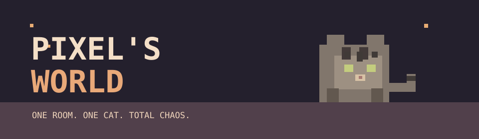

# Pixel's World 🐈

*A cozy pixel-art sandbox about a small cat and a very big mess.*

## The idea

Play as **Pixel**, a curious, mischievous tabby cat home alone in Sara's apartment. Explore a room, jump onto furniture, climb curtains and knock things over. The fun starts with tactile movement, playful physics and an environment that reacts to Pixel.

When Sara returns home at an unpredictable time, she discovers the chaos. Her frustration depends on the damage. Pixel then has a limited window to make amends by purring, cuddling and giving affectionate head bumps. The calmer Sara is at the end, the more treats Pixel earns.

**Design direction:** physics-driven sandbox first, scoring and reconciliation later. Sock hiding was the original hook, but is now an optional future mechanic.

## Gameplay loop (planned)

1. **Home alone:** explore, jump, climb and cause mischief.
2. **Sara returns:** an unpredictable arrival ends the chaos phase.
3. **Make amends:** purr, cuddle and charm Sara before time runs out.
4. **Treats:** rewards depend on Sara's remaining frustration.

## Interactions (ideas)

| Action | World reaction |
| --- | --- |
| Push a vase | It tips, falls and breaks on impact |
| Scratch couch or wallpaper | Visible scratches |
| Climb curtains | Fabric reacts; perhaps the curtain falls |
| Knock books off shelves | Books fall and scatter |
| Tip over a water bowl | A puddle forms |
| Walk through water | Wet paw prints appear |

## Controls (planned)

| Input | Action |
| --- | --- |
| ← / → | Move |
| ↑ / ↓ | Climb up/down when attached to a climbable surface |
| ↓ | Crouch when on the ground |
| Space | Jump |
| Space + ← / → | Directional jump |
| Space while climbing | Jump away from the surface |

Climbing should feel slower and more deliberate than jumping. Pixel may automatically grab a climbable surface after jumping against it.

## Visual direction

- Cozy **2D side-view pixel art** with a warm, slightly autumnal apartment palette.
- **32×32 px** as the preferred starting point for Pixel's sprite, not a fixed screen resolution or color depth.
- Pixel is a short-haired brown-gray tabby with dark stripes, a forehead M, cream-colored muzzle, yellow-green eyes and a ringed tail.
- Animations to explore: idle, run, jump/land, **back-view climbing**, sneak, push, scratch, purr, cuddle and head bump.
- Frame counts and final asset sizes are still to be tested.

## Proposed tech stack

| Area | Choice |
| --- | --- |
| Language | TypeScript |
| Engine | Phaser 3 |
| Platform | Web browser |
| Rendering | 2D pixel art at a fixed logical resolution |
| Physics | Phaser-compatible arcade-style collisions to start; richer object behavior as needed |
| Backend/accounts | None planned for the prototype |

These are **planned choices**, not claims that the project is already bootstrapped.

## First playable prototype

**Goal:** Pixel can jump from the floor onto a couch, climb toward a shelf, and knock a vase down so it falls and breaks.

- [ ] One playable room with floor, couch, shelf, curtain and platforms
- [ ] Pixel sprite and basic idle/run/jump/climb animations
- [ ] Arrow-key and space-bar controls
- [ ] Gravity, collisions, climbing, grabbing and jumping off
- [ ] One interactive vase with falling and breaking behavior

The first prototype does **not** need Sara's return, a frustration meter, treats, a complete round or user accounts. We should first establish that moving and making a mess feels fun.

## Project status

**Concept / prototype planning.** This README records design decisions and proposals, not implemented features. Issues and milestones will be tracked here as development begins.

---

*One room. One cat. Absolutely no respect for gravity or expensive vases.*
