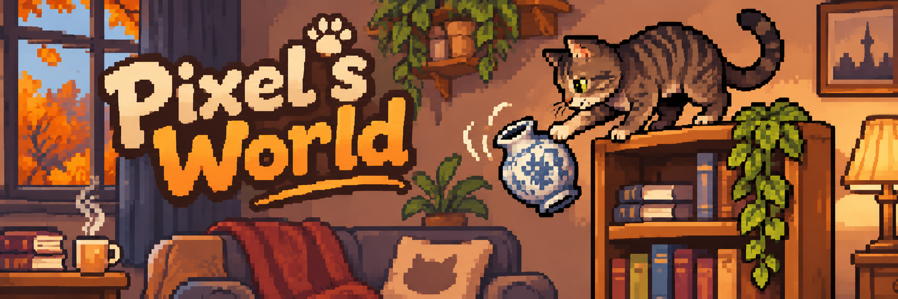

# Pixel’s World

[](https://github.com/Skanky0815/pixels-world/actions/workflows/qa.yml) [](#projektstatus) [](https://github.com/Skanky0815/pixels-world/releases)

[](https://phaser.io/) [](https://www.typescriptlang.org/) [](https://vite.dev/) [](#lokal-starten)

Die QA-Plakette zeigt den letzten Push auf `main`; die Release-Plakette zeigt veröffentlichte GitHub Releases. Das Spiel läuft im Browser, Node.js wird für die Entwicklungswerkzeuge benötigt.

**Ein Zimmer. Eine Katze. Absolut kein Respekt vor Schwerkraft oder teuren Vasen.**

*Eine gemütliche Pixel-Art-Sandbox über eine kleine Katze und ein ziemlich großes Chaos.*

## Die Idee

Spiele **Pixel**, einen neugierigen, frechen Kater, der allein in Saras Wohnung ist. Erkunde das Zimmer, springe auf Möbel, klettere an Vorhängen und wirf Dinge um. Im Mittelpunkt stehen Bewegung, spielerische Physik und eine Umgebung, die auf Pixel reagiert. **Geplant für Phase 2:** Jedes Level gibt Pixel genau ein Hauptziel, das aus ihren Bedürfnissen entsteht – etwa Futter finden, spielen oder einen gemütlichen Schlafplatz erreichen. Wie viel Unsinn sie auf dem Weg anstellt, bleibt dir überlassen.

Sara soll später zu einem unvorhersehbaren Zeitpunkt heimkommen und das Chaos entdecken. Wie verärgert sie ist, hängt vom Schaden ab. Pixel hat dann kurz Zeit, sie mit Schnurren, Kuscheln und Köpfchengeben zu versöhnen. Je ruhiger Sara am Ende ist, desto mehr Leckerlis bekommt Pixel.

**Designrichtung:** zuerst Bewegung, Physik und Chaospunkte als Grundlage für Saras Ärger; danach Rundenablauf und Versöhnung. Grafik und Animationen folgen dem spielbaren Kern. Sockenverstecken war die ursprüngliche Idee und bleibt eine optionale spätere Mechanik.

## Geplanter Spielablauf

1. **Ein Level, ein Katzenziel:** Pixel bekommt ein klares Hauptziel aus ihren Bedürfnissen, z. B. **Hunger → Futternapf**, **Spieltrieb → Spielzeug** oder **Gemütlichkeit → Schlafplatz**. Das Ziel gibt Orientierung, ohne eine feste Route vorzuschreiben.
2. **Allein zu Hause:** bewege Pixel frei durch den Raum, springe, klettere und erreiche ihr Ziel. Unterwegs sind automatische Katzenaktionen und Chaosobjekte optional – Pixel darf auch ganz friedlich sein.
3. **Sara kommt heim:** eine unvorhersehbare Ankunft beendet die Chaosphase. Wie verärgert Sara ist, hängt vom angerichteten Schaden ab.
4. **Wiedergutmachen:** schnurren, kuscheln und Sara um die Pfote wickeln.
5. **Rundenergebnis und Leckerlis:** **Ziel erreicht?**, **wie viel Chaos?** und **Saras Reaktion** werden getrennt betrachtet. Wie viele Leckerlis Pixel erhält, hängt davon ab, wie verärgert Sara am Ende noch ist.

**Umsetzungsstand:** Der spielbare Prototyp bietet bereits Bewegung, Interaktionen und Chaospunkte. Hauptziele und Bedürfnisse sind für [Phase 2 (#30)](https://github.com/Skanky0815/pixels-world/issues/30) geplant. Die spätere [Levelgenerierung (#29)](https://github.com/Skanky0815/pixels-world/issues/29) wählt Raum, Möbel und **genau ein erreichbares Hauptziel** gemeinsam aus. Ein identischer Seed soll auch dasselbe Ziel liefern.

## Interaktionen als Ideen

| Aktion | Reaktion der Umgebung |
| --- | --- |
| Vase schubsen | Sie kippt, fällt und zerbricht beim Aufprall |
| Sofa oder Tapete kratzen | Sichtbare Kratzer |
| Vorhang hochklettern | Der Stoff reagiert; vielleicht fällt der Vorhang herunter |
| Bücher vom Regal schubsen | Bücher fallen und verteilen sich |
| Wassernapf umkippen | Eine Pfütze entsteht |
| Durch Wasser laufen | Nasse Pfotenabdrücke bleiben zurück |

## Steuerung und Bewegungsrichtung

| Eingabe | Aktion |
| --- | --- |
| ← / → | Bewegen |
| ↑ / ↓ | An einer Kletterfläche auf- und absteigen |
| ↓ am Boden | Ducken, später optional |
| Leertaste | Springen |
| Leertaste + ← / → | Richtung beim Sprung steuern |
| Leertaste beim Klettern | Von der Fläche abspringen |

Klettern ist langsamer als Springen. Beim Anspringen greift Pixel den Vorhang automatisch; ↑ oder ↓ greift auch bewusst. Nach dem Absprung muss Pixel die Kletterfläche verlassen, bevor er sie erneut automatisch greifen kann. Plattformkollisionen bleiben beim Klettern aktiv. Sprünge behalten ihren horizontalen Schwung, Richtungstasten erlauben begrenzte Luftsteuerung.

## Visuelle Richtung

- Gemütliche **2D-Seitenansicht in Pixel-Art** mit warmer, leicht herbstlicher Wohnungspalette.
- **32×32 px** als bevorzugter Ausgangspunkt für Pixels Sprite, keine feste Bildschirmauflösung oder Farbtiefe.
- Pixel ist ein kurzhaariger braun-grauer Tigerkater mit dunklen Streifen, einem M auf der Stirn, heller Schnauze, gelbgrünen Augen und geringeltem Schwanz.
- Geplante Animationen: stehen, laufen, springen/landen, **Klettern in Rückansicht**, schleichen, schubsen, kratzen, schnurren, kuscheln und Köpfchengeben.
- Frame-Anzahl und endgültige Asset-Größen müssen noch erprobt werden.

## Technik

| Bereich | Wahl |
| --- | --- |
| Sprache | TypeScript |
| Engine | Phaser 3 |
| Plattform | Webbrowser |
| Darstellung | 2D-Pixel-Art mit fester logischer Auflösung |
| Physik | Zunächst Arcade-Kollisionen; komplexeres Objektverhalten bei Bedarf |
| Backend und Konten | Für den Prototyp nicht erforderlich |

Der Raumprototyp verwendet Phaser 3, TypeScript und Vite. Weitere Spielsysteme sind geplant.

## Erster spielbarer Prototyp

**Ziel:** Pixel kann vom Boden aufs Sofa springen, zum Regal klettern und eine Vase herunterstoßen, die fällt und zerbricht.

- [x] Spielbarer Raum mit Boden, Sofa, Regalen, Vorhang und Plattformen
- [x] Pixel-Sprite mit grundlegenden Stand-, Lauf-, Sprung- und Kletteranimationen
- [x] Pfeiltasten- und Leertastensteuerung, ohne optionales Ducken
- [x] Bewegung mit Schwerkraft, Kollisionen, Sprungschwung, Klettern, automatischem Greifen und Absprung
- [x] Interaktive Vasen mit Fall- und Bruchverhalten
- [x] Chaospunkte und konfigurierbare Ärger-Vorschau

Der spielbare Kern umfasst jetzt Bewegung, Zerstörung und Punkte. Saras tatsächliche Rückkehr, Versöhnung, Leckerlis und eine vollständige Runde folgen später; Benutzerkonten sind nicht erforderlich.

## Projektstatus

**Spielbare Chaos-Sandbox mit Platzhaltern.** Der Raum verwendet geometrische Platzhalter, einen festen Boden, Sofa- und Regalplattformen sowie einen markierten kletterbaren Vorhang. Die Kamera zeigt den ganzen Raum mit 960×540 logischen Pixeln und skaliert ihn passend zum Browser. Zur Laufzeit sind weder Backend noch Konten oder externe Grafikdownloads nötig. Drei Vasen lassen sich durch Kontakt anschubsen und zerbrechen beim Bodenaufprall. Pixel verwendet jetzt den bestätigten 32×32-Master mit Idle-, Lauf-, Sprung-/Lande- und Kletteranimationen. Saras Heimkehr und der Rundenablauf folgen später. Der [Issue-Abgleich](docs/gameplay-status.md) zeigt abgeschlossene Grundlagen und offene Meilensteinaufgaben.

## Lokal starten

Voraussetzung: Node.js 22.12+ oder eine unterstützte neuere LTS-Version sowie npm.

```sh
npm ci
npm run dev
```

Die von Vite ausgegebene lokale Adresse öffnen, üblicherweise http://127.0.0.1:5173. Eine Tastatur ist erforderlich; Touch-Steuerung ist noch nicht enthalten.

- **← / →:** bewegen.
- **Leertaste:** springen; horizontaler Schwung bleibt beim Loslassen erhalten. Richtungstasten steuern in der Luft begrenzt nach. Vor der Sofakante abspringen, um über die feste Seite zu kommen.
- **↑ / ↓ am markierten Vorhang:** greifen und klettern; Anspringen greift automatisch. Ohne ↑ rutscht Pixel langsam hinunter; ↓ beschleunigt den Abstieg. Seitlich die Fläche verlassen oder mit Leertaste abspringen – standardmäßig nach links, sonst in die gehaltene Richtung.
- **R:** Durchlauf neu starten: Pixel, sämtliche Vasen, Sofakratzer, Vorhangrisse, Pflanze, Splitter und Punkte zurücksetzen.

Bücher, Sofalehne und Bild sind Dekoration. Der Katzengrastopf links ist interaktiv: kurz daneben stehen bleiben, um zu knabbern; Weglaufen oder Springen verhindert das spätere Umkippen. Die Sitzfläche und Regalbretter bilden die festen Möbelplattformen.

## Build und Vorschau

```sh
npm run build
npm run preview
```

Der Build prüft TypeScript und erzeugt die statische Website unter `dist/`. Phaser wird lokal gebündelt; Vite kann wegen der Engine einen Hinweis zur Bundle-Größe ausgeben.

## Manueller Spieltest

1. Lokal starten: Der gesamte Raum, Pixel, Sofa, Regale und der markierte Vorhang sind sichtbar.
2. Links und rechts laufen: Boden und Raumgrenzen halten Pixel auf.
3. Von der Startposition nach rechts aufs Sofa springen. Zur rechten Kante laufen und auf das erste Regal springen; danach das nächste Regal erreichen. Pixel landet auf den sichtbaren Flächen.
4. Am Vorhang ↑ halten: Pixel klettert. Loslassen zum langsamen Abrutschen mit Stoffschaden, ↓ zum schnelleren Absteigen und Leertaste mit einer Richtung zum Abspringen. Nach dem Verlassen wirkt wieder Schwerkraft.
5. Auf einer Plattform oder beim Klettern R drücken: Pixel kehrt zur Startposition zurück.
6. Die erste Vase auf dem Regal von links anschubsen. Beim Kontakt bleiben die Punkte unverändert; erst der Bodenaufprall liefert 25 Punkte und sichtbare Splitter. Warten/erneutes Berühren zählt nicht nochmals.
7. Am Vorhang zur zweiten Vase klettern und sie nach links vom Regal schieben. Nach deren Bruch liefern die beiden Vasen zusammen 60 Punkte; Vorhangrisse können zusätzliche Punkte beitragen. Beim seitlichen Regalwechsel wegen des Abrutschens etwas höher ansetzen.
8. R drücken: alle Vasen stehen wieder, Splitter verschwinden und Punkte/Ärger-Vorschau sind zurückgesetzt.
9. Browsergröße ändern: Der gesamte Raum bleibt im ursprünglichen Seitenverhältnis sichtbar.

## Qualitätsprüfungen

```sh
npm run lint       # ESLint mit TypeScript-Regeln; Warnungen führen zum Fehler
npm run typecheck  # Strenge TypeScript-Prüfung
npm run test:unit  # Punkte, Doppeltzählung, Reset und Ärgerschwellen
npm run qa         # Lint, Unit-Tests, Typprüfung und Produktionsbuild
```

GitHub Actions startet die vollständige Game-QA bei Pull Requests und Pushes nach `main`, die Spielcode, Assets, Tests, Werkzeuge oder gemeinsame Konfigurationen ändern. Reine Dokumentationsänderungen starten sie nicht. Ein manueller Start prüft immer vollständig. Pfadregeln und Hinweise zum Branch-Schutz stehen in [Gezielte Game-QA](docs/qa.md). CI installiert mit `npm ci` aus dem Lockfile auf Node.js 22. Der manuelle Spieltest ergänzt die statischen Prüfungen. Der separate CI-Job **Playwright (Chromium)** prüft Start und Rendering, Tastaturbewegung, Boden/Raumgrenze, Sofa-/Regalsprünge, Vorhangklettern mit Absprung, Reset und einen kleinen Viewport. Zusätzliche Gameplay-Tests prüfen Sprungschwung, automatisches Greifen, Kletterkollisionen, fallende Vasen, einmalige Punktevergabe, Ärgerstufen und vollständigen Reset. Außerdem prüft er, dass der Produktionsbuild keine Test-Schnittstelle enthält.

## Beiträge

Das [Architekturreview #22](docs/reviews/2026-11-02-architecture.md) dokumentiert den geprüften Stand und konkrete Folgeaufgaben. Das [Gameplay-Zielbild](docs/architecture/gameplay.md) beschreibt die vorgeschlagene Trennung von Szene, Pixel, Controls, interaktiven Objekten und HUD; das HUD ist als erster Schritt unter `src/game/ui/` isoliert, die übrige Migration steht noch aus.

Sprache, Commits und Review-Ablauf sind in [CONTRIBUTING.md](CONTRIBUTING.md) beschrieben. Die Arbeitsregeln für Agenten stehen in [AGENTS.md](AGENTS.md).

## Versionierung

Startversion ist `0.1.0`. Release Please bereitet aus Conventional Commits einen Versions-PR samt Changelog vor. Nach Review, Merge und erneuter QA wird ein GitHub Release mit Tag `vX.Y.Z` bewusst veröffentlicht. Der Ablauf steht unter [Versionierung und Releases](CONTRIBUTING.md#versionierung-und-releases). Ein Eintrag in `package.json` allein bedeutet noch keinen veröffentlichten Release.


## End-to-End-Tests

```sh
npm ci
npx playwright install chromium
npm run test:e2e
```

Playwright baut und startet selbst zwei lokale Vorschauen auf den Ports **4174** (E2E-Build) und **4175** (Produktionsbuild). Die Ports müssen frei sein; ein vorhandener Server wird nicht übernommen. Der normale Entwicklungsserver auf 5173 bleibt davon unabhängig. Die Suite verwendet echte Tastatureingaben; sie setzt keine Spielfigurenpositionen.

```sh
npm run test:e2e -- --repeat-each=3  # Stabilitätsprüfung ohne automatische Retries
npm run test:e2e -- --workers=1     # Serieller Lauf bei knappen Ressourcen
npm run test:e2e:debug              # Sichtbarer Browser und Playwright Inspector
npm run test:e2e:report             # Letzten HTML-Bericht öffnen
```

Auf Linux bei Bedarf einmal `npx playwright install --with-deps chromium` ausführen. CI führt jeden Test zweimal ohne automatische Retries aus, installiert Chromium samt Systemabhängigkeiten und speichert den HTML-Bericht sowie Screenshots/Traces fehlgeschlagener Tests für 14 Tage getrennt je Teil-Suite als `playwright-results-1` und `playwright-results-2`. Ein Trace lässt sich mit `npx playwright show-trace <pfad-zur-trace.zip>` öffnen.

Lokal laufen Tests isoliert mit zwei Workern, auch innerhalb derselben Testdatei, und geben Tasten im Cleanup frei. CI verteilt die vollständige Suite mit Playwrights `--shard=1/2` und `--shard=2/2` auf zwei unabhängige Runner mit je einem Worker. `fullyParallel` erlaubt die Aufteilung einzelner Tests statt ganzer Dateien. Der Gesamtcheck **Playwright (Chromium)** wird nur grün, wenn beide Teil-Suites erfolgreich sind; ein Fehler bricht die andere Teil-Suite nicht vorzeitig ab. Jeder Test besitzt seinen eigenen Browser-Kontext und seine eigene pausierte Uhr; die statischen Vorschau-Server werden gemeinsam genutzt. Ein Worker je CI-Runner vermeidet Konkurrenz beim Software-Rendering; zwei lokale Worker nutzen die lokale Hardware. Bei knappen Ressourcen lässt sich mit `--workers=1` seriell ausführen; `--workers=N` überschreibt die Vorgabe auch in CI. Testabdeckung, doppelte CI-Ausführung und null automatische Retries bleiben unverändert.

Playwrights Browser-Uhr ist vor dem Laden installiert und pausiert; zwischen Zustandsabfragen werden Timer und Animationen in kleinen Simulationsschritten weitergeführt. So verlängert die Antwortzeit eines langsamen CI-Runners keine Tastatureingaben. Abbruchgrenzen und tolerante Ergebnisprüfungen ersetzen feste Echtzeitpausen und exakte Frame-Positionen.

Nur `vite build --mode e2e` enthält die lesbare, unveränderliche Beobachtungsschnittstelle `window.__pixelTest`. Sie liefert Bereitschaft, Szene, Frame, Kamera und Pixels Bewegungszustand als eingefrorene Kopien, ohne Mutatoren oder Phaser-Objekte. `npm run build` entfernt den gesamten Beobachter durch Vites Modusauswertung; ein eigener Test prüft den ausgelieferten Produktionscode darauf. Der manuelle Spieltest bleibt für das Spielgefühl sinnvoll; Cross-Browser- und pixelgenaue Screenshot-Tests sind noch nicht enthalten.


## Chaospunkte und Ärger-Vorschau

| Objekt | Punkte beim Bodenbruch |
| --- | ---: |
| Kleine Vase auf dem ersten Regal | 25 |
| Blaue Vase auf dem mittleren Regal | 35 |
| Erbstück auf dem oberen Regal | 40 |

Die HUD-Vorschau für Saras Ärger ist **entspannt** unter 25 Punkten, **genervt** ab 25 und **wütend** ab 60. Die Leiste reicht bis zu den insgesamt möglichen 162 Punkten: 100 für Vasen, 18 für Sofakratzer, 32 für Vorhangrisse und 12 für die Pflanze. Werte und Schwellen stehen in [src/chaos.ts](src/chaos.ts). Berührung, Anschubsen und ein Zwischenstopp auf einem anderen Regal zählen noch nicht als Schaden. Vasen zählen erst beim tatsächlichen Bodenbruch und höchstens einmal pro Durchlauf. Sofa-, Vorhang- und Pflanzenschäden zählen je neuer Schadensstufe einmal; dasselbe Möbel zählt dabei als ein beschädigtes Objekt.

Die Vasen verwenden dieselbe Arcade-Physik wie Pixel. Nach einem seitlichen Anschubser gleiten sie über die Kante, fallen mit Schwerkraft und zeigen beim Bodenaufprall einfache Splitter. Die sichtbare Drehung ist Platzhalterfeedback; es gibt noch keine vollständige Starrkörper-/Stoffsimulation. Mehrere Vasen dienen dem Test der Punktebereiche; Bücher bleiben Dekoration; die Pflanze hat ihre eigene kleine Interaktion. Weitere Objektarten gehören zu #11.

Der HUD-Ausblick ist noch keine heimgekehrte oder tatsächlich reagierende Sara. Timer/Heimkehr (#6), Saras Reaktion und Phasenwechsel (#8), Versöhnung (#9) sowie die vollständige Ergebnisrunde (#10) bleiben eigenständige nächste Schritte. Die Grundanimationen aus #2 ergänzen jetzt den Gameplay-Kern; weitere grafische Verfeinerung bleibt möglich.


## Automatisches Sofakratzen (Phase 1)

Bleibt Pixel etwa **zwei Sekunden** am Sofa stehen, beginnt sie ohne Aktionstaste zu kratzen. Das funktioniert am Boden vor dem Sofa und auf seiner Sitzfläche. Drei 32×32-Frames und bewegte Pfoten zeigen das Kratzen; alle **750 ms** kommt eine sichtbare Spur hinzu. Pro Durchlauf sind höchstens **sechs Schadensstufen** möglich.

Bewegen oder Springen beendet die Aktion sofort. Vorhandene Kratzer bleiben, beim erneuten Stillstehen läuft die volle Wartezeit von vorn. **R** entfernt die Kratzer und setzt Interaktion und Ereigniszähler zurück. Reichweite, Wartezeit, Intervall, Schadensgrenze und Ereigniswert stehen in [src/couch-scratching.ts](src/couch-scratching.ts).

Jede neue Spur emittiert über die Phaser-Szene ein unveränderliches `object-damaged`-Ereignis mit `objectId: couch`, `kind: scratch`, Schadensstufe und `value: 3`. Das vorhandene Scoring zählt jede neue Kratzstufe einmal: **3 Punkte je Stufe, höchstens 18 pro Durchlauf**. Wiederholtes Ausgeben derselben Stufe kann keine zusätzlichen Punkte erzeugen. Das Sofa zählt als ein beschädigtes Objekt; die Vasen behalten ihre bisherigen Werte. R setzt sowohl Kratzschaden als auch Punkte zurück.

Konfigurierte Sofapunktwerte müssen nicht negative sichere Ganzzahlen sein; null ist erlaubt. Ungültige Werte werden bereits beim Erzeugen des Sofamodells abgelehnt, bevor die Interaktion Schaden erzeugen kann.

Zum manuellen Prüfen am Boden auf Höhe des Sofas anhalten: vor zwei Sekunden kein Kratzen, danach Animation und schrittweise Spuren. Weglaufen oder springen beendet die Animation; R entfernt den Schaden. Unit- und E2E-Tests prüfen Verzögerung, Intervalle, Abbruch, Animation, Schadensgrenze und Neustart.


## Vorhangrutschen und Risse (Phase 1)

Am Vorhang hält **↑** Pixel beim Hochklettern. Ohne Aufwärts-Eingabe rutscht sie mit **35 px/s** hinunter; **↓** beschleunigt auf **125 px/s**. Das bisherige bewegungslose Hängenbleiben entfällt. Weiterklettern und Abspringen beenden die Rutschphase; Plattformkollisionen bleiben aktiv. Trifft Pixel beim Rutschen auf Boden oder eine Plattform, löst sie den Griff automatisch. Vom Boden lässt sich mit ↑ sofort erneut greifen und klettern.

Nur beim tatsächlichen Hinabrutschen entsteht alle **600 ms** ein sichtbarer Riss. Jeder neue Riss gibt **4 Chaospunkte**, höchstens achtmal bzw. 32 Punkte pro Durchlauf. Weiterklettern oder Ablösen unterbricht das laufende Schadensintervall; bestehende Risse bleiben erhalten. **R** entfernt Risse und setzt Vorhangzustand, Ereignisse und Punkte zurück.

Geschwindigkeiten, Schadensintervall, Schadensgrenze und Ereigniswert stehen in [src/curtain-sliding.ts](src/curtain-sliding.ts). Risse emittieren eingefrorene `object-damaged`-Ereignisse mit `objectId: curtain`, `kind: tear`, Stufe und Wert. Es gibt keine Ereignisflut pro Frame oder nach einem langen Frame. Das ist ein spielbarer Stoffschaden mit Platzhalterlinien, keine Stoffsimulation.

Zum Prüfen hinaufklettern und loslassen: Pixel rutscht sichtbar, nach dem Intervall entstehen Risse und Punkte. ↑ stoppt den Rissfortschritt, Leertaste löst den Griff. Am Boden endet das Rutschen; ↑ greift erneut, R stellt den unbeschädigten Vorhang wieder her. Automatisierte Tests prüfen Zustandswechsel, Bewegung, Punkte, Unterbrechungen, Bodenbegrenzung und Neustart.


## Katzengras anknabbern und Topf umwerfen (Phase 1)

Links am Boden steht ein Platzhalter für Katzengras. Geh von der Startposition ein kleines Stück nach links und bleib neben dem Topf stehen. Nach **zwei Sekunden** beginnt Pixel automatisch zu knabbern; zwei Animationsframes und bewegte Halme zeigen die Aktion. Nach **einer weiteren Sekunde** wackelt der Topf deutlich, begleitet vom Hinweis im HUD. Erst nach **1,2 Sekunden Warnzeit** kippt er nach links und Erde bleibt am Boden liegen. Es gibt keine Zufallsentscheidung und keine Aktionstaste.

Bewegung, Richtungseingaben oder Springen unterbrechen die Folge sofort; vor dem Kippen richtet sich der Topf wieder auf. Ein vorhandener Biss bleibt sichtbar. Bei erneuter Annäherung läuft die volle Wartezeit von vorn. Am Startpunkt, außerhalb der Reichweite und in der Luft beginnt keine Interaktion. Der erste Biss gibt einmal **2 Chaospunkte**, das Kippen weitere **10**. Auch nach erneutem Annähern gibt es denselben Schaden nicht doppelt; die Pflanze zählt als ein beschädigtes Objekt.

**R** stellt Topf und Halme aufrecht wieder her, entfernt Erde, Ereignisse und Punkte und beendet die Knabberanimation. Wartezeit, Knabberdauer, Warnzeit, Reichweite und Punkte stehen in [src/plant-nibbling.ts](src/plant-nibbling.ts). Eingefrorene `object-damaged`-Ereignisse enthalten `objectId: plant`, `kind: nibble` bzw. `tip`, Stufe und Wert. Langframes können nicht mehrere Phasen auf einmal überspringen. Das Kippen ist eine feste Platzhalterdarstellung, keine zusätzliche Starrkörperphysik.

Zum Prüfen erst bis zum Wackeln warten und weglaufen: Der Topf bleibt stehen. Dann erneut warten, bis er kippt: insgesamt 12 Punkte, keine weitere Punktevergabe. R stellt alles wieder her. Unit- und Browser-Tests prüfen Phasengrenzen, Unterbrechungen, Animation, Warnung, einmalige Punkte und Reset.


## Pixels Animationen: 32×32-Grafik, 64×64-Darstellung

Der erste Idle-Frame ist exakt der von Rico bestätigte Pixel-Master v3. Das lokale Sprite-Sheet enthält 25 Zellen à **32×32 Pixel**: Sitzen mit Atmen/Blinzeln, einen seitlichen Laufzyklus, Aufstieg/Scheitelpunkt/Fall, kurze Landung sowie Klettern und Rutschen in **Rückansicht**. Kratzen und Knabbern verwenden ebenfalls Posen aus diesem Sheet. Linksbewegung spiegelt den seitlichen Lauf; Klettern zeigt den Rücken.

Die Animation folgt der vorhandenen Physik. Neue Bewegung unterbricht die Landepose; Springen und Klettern verdrängen Bodenaktionen. R setzt auf Idle zurück. Die Grunddarstellung des 32×32-Originals ist ohne Glättung **64×64**. Ein sichtbares Sprite folgt dem festen Physikkörper am Pfotenanker: kompakter Lauf und Idle verwenden Faktor 2, Klettern/Rutschen Faktor 2,5 (80×80); die ursprünglich kleiner angelegten Aktionsposen eine größere Zeichenfläche (94×94 für Sprung/Fall/Landung, 80×80 beim Knabbern und Kratzen). So schrumpft Pixel beim Zustandswechsel nicht in die alte, kleinere Körperwirkung zurück; gestreckte Posen dürfen eine größere Zeichenfläche belegen. Die ebenfalls skalierte Kollisionsfläche misst **52×52** Spielpixel und ist horizontal zentriert; Start und Reset richten die Pfoten am Boden aus. Animationsframes verändern weder Reichweiten, Bewegungsgeschwindigkeiten noch Schadensintervalle.

[Sheet, Framebelegung und Aufbereitung](assets/pixel/README.md) dokumentieren Originalvorlage, Bildwerkzeug-Prompt und reproduzierbares Packen. Die Engine lädt nur das kleine 160×160-Sheet; Vorlage und Kontrollansicht werden nicht mitgeliefert. Einstellungen und Zustandsauswahl stehen in [src/pixel-animations.ts](src/pixel-animations.ts). Zum Prüfen kurz stehen bleiben, laufen und Richtung wechseln, senkrecht springen/landen und am Vorhang hochklettern. Bei der obersten Vase erst links neben ihr auf dem Regal landen und dann seitlich anschubsen; von ganz oben kann Pixel darübersteigen.

### Animationen direkt vergleichen

Bei laufendem Entwicklungsserver öffnet [Animationsvergleich](http://127.0.0.1:5173/animation-compare.html) eine separate Arbeitsansicht. Jede Pose steht neben dem bestätigten Idle-Master auf derselben Pfotenlinie. Pause, Einzelschritt und Größenregler helfen beim Beurteilen; die Regler ändern ausschließlich die Vorschau. Andere Posen lassen sich je Karte auswählen. Die Ansicht verwendet dasselbe Sheet und dieselben Größen wie das Spiel, ist ausdrücklich nur im Dev-Betrieb erlaubt. `vite.config.ts` baut ausschließlich die Spielseite; E2E- und Produktionsvorschau liefern für die Vergleichsseite und ihre Quelldateien 404 statt einer SPA-Weiterleitung. Eine zusätzliche Laufzeitprüfung verhindert den Start außerhalb von `import.meta.env.DEV`.
