# Pixel-Slack-Emojis

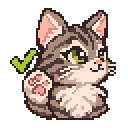 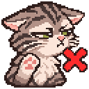 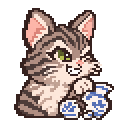 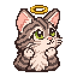 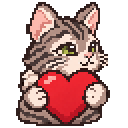 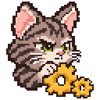 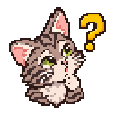 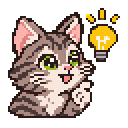 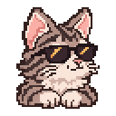 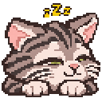 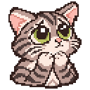 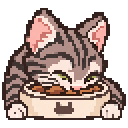 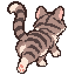 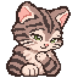 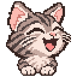

Fünfzehn statische Reaktionen im Stil von Pixels freigegebenem Porträt und Idle-Master:

| Datei                     | Slack-Name              | Motiv                                                                                |
| ------------------------- | ----------------------- | ------------------------------------------------------------------------------------ |
| `pixel_approved.png`      | `:pixel_approved:`      | Okay / Zustimmung: Approval-Pfote mit grünem Haken                                   |
| `pixel_nein.png`          | `:pixel_nein:`          | Nein: zurückgelegte Ohren, skeptischer Blick, abwehrende Katzenpfote und rotes Kreuz |
| `pixel_chaos.png`         | `:pixel_chaos:`         | Zufriedener Pixel mit kaputter Vase                                                  |
| `pixel_war_nicht_ich.png` | `:pixel_war_nicht_ich:` | Unschuldsblick mit Heiligenschein                                                    |
| `pixel_love.png`          | `:pixel_love:`          | Pixel hält ein großes rotes Herz                                                     |
| `pixel_in_progress.png`   | `:pixel_in_progress:`   | Konzentrierter Pixel mit Zahnrädern                                                  |
| `pixel_muede.png`         | `:pixel_muede:`         | Kopf auf den Pfoten mit goldenen zZz-Schlafzeichen                                   |
| `pixel_bitte.png`         | `:pixel_bitte:`         | Große grüne Kulleraugen und beide Pfoten unterm Kinn                                 |
| `pixel_essen.png`         | `:pixel_essen:`         | Mittagspause: Pixel frisst aus einem großen Napf                                     |
| `pixel_afk.png`           | `:pixel_afk:`           | Pixel tapst mit erhobenem Schwanz davon                                              |
| `pixel_danke.png`         | `:pixel_danke:`         | Dankbares Nicken mit einer Pfote an der Brust                                        |
| `pixel_lol.png`           | `:pixel_lol:`           | Lachender Pixel mit zugekniffenen Augen und offenem Mäulchen                         |
| `pixel_urlaub.png`        | `:pixel_urlaub:`        | Entspannter Pixel mit Sonnenbrille                                                   |
| `pixel_idee.png`          | `:pixel_idee:`          | Begeisterter Pixel mit Glühbirne                                                     |
| `pixel_question.png`      | `:pixel_question:`      | Frage / Weiß nicht: schiefes Köpfchen mit Fragezeichen                               |

`pixel-slack-emojis.zip` enthält die fünfzehn Upload-PNGs und `Namen.txt`.
Entpacken, in Slack das Emoji-Menü öffnen, „Emoji hinzufügen“ wählen und die PNGs
mit den Namen aus der Tabelle einzeln hinzufügen. Die lokale `preview.html` zeigt
128-, 32- und 22-Pixel-Proben auf hellen und dunklen Hintergründen.

Die PNGs sind 128×128 Pixel groß, transparent und jeweils kleiner als 128 KB,
entsprechend [Slacks Empfehlung](https://slack.com/help/articles/206870177-Add-custom-emoji-and-aliases-to-your-workspace).
Die tatsächliche Darstellung hängt von Slack, Zoom und Gerät ab. Die Dateien
werden als eigenständiges Zusatzset gepflegt und nicht ins Spiel importiert.

## Bestandsabgleich und Erweiterung

Die vorhandenen Motive decken Zustimmung, Ablehnung, Unwissen, Chaos/Unfug, Unschuld, Liebe, Arbeit, Ideen/Begeisterung und Urlaub ab und werden unverändert wiederverwendet. Gemeinsam ausgewählt sind sechs Ergänzungen: Müde, Bitte, Mittagspause, AFK, Danke und LOL. Weitere Kandidaten aus #371 sind nicht Teil dieses Sets.

## Quellen und Export

Die unveränderten, mit dem integrierten Bildwerkzeug erzeugten Originale liegen in
`sources/`; die vollständigen [Prompts](generation-prompts.md) enthalten die Rollen
der Referenzen. Grundlage sind `assets/team/pixel-portrait-v3.png` und
`assets/pixel/pixel-idle-master.png` aus demselben Repository.

`node tools/assets/prepare-slack-emojis.mjs` exportiert das Set mit `pngjs` und dem
Systemwerkzeug `zip`. Die Motivgrenzen berücksichtigen Alpha ab 192. Ein
62-Pixel-Motivbereich im logischen 64×64-Raster nutzt die Fläche proportional bis
auf mindestens zwei transparente Exportpixel pro Seite aus; bei schmaleren oder
flacheren Motiven bleibt auf der kürzeren Achse mehr Rand. Anschließend wird ohne
Glättung zweifach auf 128×128 vergrößert. Übernommene
RGB-Werte bleiben erhalten, Alpha wird binär. Die Quellen werden nicht geändert.
Der Export prüft die Dateigröße und erzeugt Namensliste, Vorschau und ZIP erneut.

## Landingpage-Download

Der Export kopiert die fünfzehn Vorschaubilder nach
`public/downloads/pixel-slack-emojis/` und das ZIP nach
`public/downloads/pixel-slack-emojis.zip`. Die Landingpage zeigt die Motive auf
Desktop ab 1001 Pixeln mit fünf Spalten und drei Reihen, auf Tablets mit drei und auf dem Handy mit zwei Spalten und bietet einen direkten
Download ohne Anmeldung. Texte und Bildbeschreibungen sind DE/EN vorhanden.
Die kleinen PNG-Vorschauen sind für die Offline-Landingpage im Workbox-Cache enthalten; das ZIP bleibt ausgeschlossen. Die großen Quellen bleiben ausschließlich hier im Asset-Verzeichnis.
