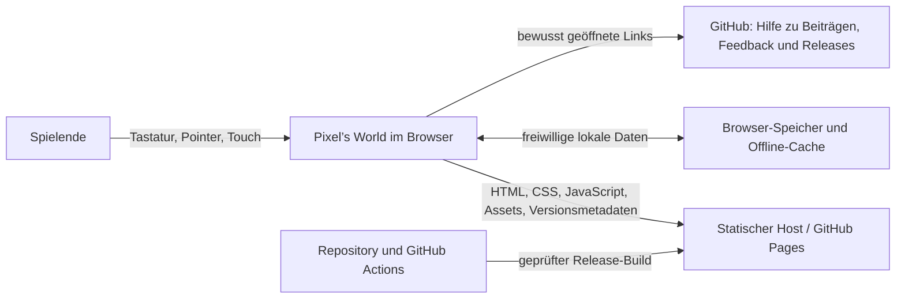

# Architektur von Pixel’s World

Diese Architekturdokumentation folgt der [deutschen arc42-Gliederung](https://arc42.de/overview/).
Sie beschreibt die implementierten Verträge. Offene Änderungen stehen in Abschnitt 11;
Arbeitsanleitungen bleiben bei ihren jeweiligen Verantwortlichen:

| Aufgabe                                    | Maßgebliche Anleitung                                                                                                                                                                                         |
| ------------------------------------------ | ------------------------------------------------------------------------------------------------------------------------------------------------------------------------------------------------------------- |
| Spielen und lokal starten                  | [README](../../README.md)                                                                                                                                                                                     |
| Entwickeln, Beiträge und Releases bedienen | [CONTRIBUTING](../../CONTRIBUTING.md)                                                                                                                                                                         |
| Räume, Varianten und Balancing pflegen     | [Content](../../game/play/content/README.md)                                                                                                                                                                  |
| Prüfen und Ergebnisse auswerten            | [CONTRIBUTING](../../CONTRIBUTING.md#qualität-prüfen)                                                                                                                                                         |
| Build- und Releaseabläufe prüfen           | [GitHub-Workflows](../../.github/workflows) und zugehörige Skripte                                                                                                                                            |
| Grafiken und Audio bearbeiten              | Anleitungen bei [Pixel](../../assets/pixel/README.md), [Sara](../../assets/sara/README.md), [Objektfamilien](../../game/play/content/README.md#vorschau-und-assets) und [Audio](../../assets/audio/README.md) |

## 1. Einführung und Ziele

Pixel’s World ist eine Browser-Sandbox: Pixel erkundet handgebaute Räume, erreicht
ein Hauptziel oder verursacht Chaos und trifft anschließend auf Sara. Eine Runde
endet mit einer bestätigten Heimkehr und gegebenenfalls einer Versöhnung.
Album und Erfolge belohnen erfolgreich abgeschlossene Runden.

| Beteiligte                                    | Erwartung                                                                             |
| --------------------------------------------- | ------------------------------------------------------------------------------------- |
| Spielende mit Tastatur oder Touch             | Erreichbare Ziele, lesbare Texte, verständliche Rückmeldung und kontrollierbare Pause |
| Rico als Produktverantwortlicher und Reviewer | Lokal prüfbare Änderungen, abgestimmte Gestaltung und nachvollziehbare Releases       |
| Beitragende                                   | Klare Modulgrenzen, wiederverwendbare Regeln und reproduzierbare Assets               |

Die wichtigsten Qualitätsziele sind konsistente Spielregeln über Eingabearten und
Bildschirmgrößen hinweg, verlässlicher Lebenszyklus ohne doppelte Wertung,
freiwillige lokale Speicherung und überprüfbare Auslieferung. Konkrete Szenarien
stehen in [Abschnitt 10](#10-qualitätsanforderungen).

## 2. Randbedingungen

- Ein frontend-only npm-/Vite-Projekt mit TypeScript und Phaser; kein Konto und kein Backend.
- Statische Auslieferung am Root, unter dem GitHub-Pages-Unterpfad und als entpackbares Release-ZIP.
- Canvas 2D als einheitlicher Renderer; Größenwechsel starten keine neue Szene.
- Deutsche und englische Spieloberfläche, statische deutsche Rechtsseiten.
- Bestehende Content-/Album-IDs, veröffentlichte Erfolgsziele und lesbare alte Speicherformate erhalten.
- Arbeitsregeln, Reviews und Dokumentationssprache stehen in [CONTRIBUTING](../../CONTRIBUTING.md), Agentenregeln in [AGENTS](../../AGENTS.md).
- Rechtsangaben und Quellen werden redaktionell nicht neu entschieden; Grundlage ist die [rechtliche Dokumentation](../legal/phase2-review.md).

## 3. Kontextabgrenzung

Der Browser führt die vollständige Runde aus. Lokale Einstellungen und Albumdaten
werden nicht an einen Spielserver gesendet. Die Online-Updateprüfung liest
Versionsmetadaten vom eigenen Host. Feedback- und Releaselinks öffnen externe
GitHub-Seiten; sie sind keine automatische Telemetrie. Rechtliche Einordnung und
Datenflüsse bleiben in der [rechtlichen Dokumentation](../legal/phase2-review.md).

## 4. Lösungsstrategie

Reine Modelle entscheiden über Zeit, Schaden, Ziel, Heimkehr, Versöhnung und
Fortschritt. Phaser-Adapter setzen Körper, Kollisionen und sichtbare Figuren um;
DOM-/Canvas-Ansichten lesen Darstellungsdaten und entscheiden keine Spielregeln.
Ein gemeinsamer Input-Snapshot und eine Aktivitätsgrenze verbinden beide Ebenen.

Typisierte Räume und Objektvorlagen werden vor dem Engine-Start validiert und
über bekannte Fabriken aufgebaut. Verhalten bleibt Code, Platzierung und
Varianten bleiben Content; es gibt keine allgemeine ausführbare Regelsprache.
Objekte kombinieren benötigte Fähigkeiten statt einer universellen Phaser-Basisklasse.
Gemeinsame Kontaktregeln verbinden sie ohne dauerhafte Paar-Whitelist.

Landingpage und Spiel teilen reine Grundlagen, keine Anwendungslogik. Vite setzt
statisches HTML und getrennte Einstiege zu einer Website zusammen. DEV- und
E2E-Helfer werden an ausdrücklichen Buildgrenzen isoliert.

## 5. Bausteinsicht

### Anwendungsbereiche und Importgrenzen

| Quellbereich       | Verantwortung                                     | Erlaubte interne Ziele                       |
| ------------------ | ------------------------------------------------- | -------------------------------------------- |
| `game/landingpage` | Landingpage, Hilfe, Rechts-/Update-Seiten         | Landingpage und Shared                       |
| `game/play`        | Spiel, Content und Spielansichten                 | Spiel und Shared; DEV nur wie unten begrenzt |
| `game/shared`      | Browser-, Sprach-, Eingabe- und UI-Grundlagen     | ausschließlich Shared                        |
| `game/dev`         | Lokale Vergleichs-, Objekt- und Diagnosewerkzeuge | DEV, Spiel und Shared                        |

Landingpage und Spiel importieren sich nicht gegenseitig. Shared importiert weder
Szene noch Phaser. Die Landingpage lädt weder Phaser noch das Spielstylesheet.
Konfiguration, `tools/`, Tests und Assetquellen bleiben außerhalb der Anwendung.

Unter `tools/` liegen Buildmodule in `build/`, Releasevorbereitung und
Release-Note-Prüfung in `release/`, Assetexporte in `assets/`, Prüfwerkzeuge und
Browserprofile in `qa/` sowie die lokale Hookinstallation in `hooks/`.
Assetexporte lösen Quellen und Ausgaben relativ zu ihrer Datei auf; ihre
familienbezogenen Anleitungen unterscheiden Originale, Laufzeitdateien,
Vorschauen und veröffentlichte Downloads.
Napf, Vorräte, Mülleimer und Tischdecke teilen nur die reinen Alpha-Bounds- und
2×2-Kopierfunktionen aus [pixel-export.mjs](../../tools/assets/pixel-export.mjs).
Quellenversion, Zielmaße, Alpha-Schwelle und deckender bzw. zugeschnittener
Export bleiben im jeweiligen Werkzeug festgelegt; andere Familien behalten
ihre eigenen Abtast- und Ankerregeln.

[Importregeln](../../tools/qa/import-boundaries.mjs) und die ergänzende Syntaxprüfung
lösen auch Typimporte, Re-Exports und Aliase auf. Quellbrücken über Tools oder Tests
umgehen keine Bereichsgrenze. Unauflösbare Importe werden abgewiesen;
`virtual:pwa-register` ist die freigegebene virtuelle Ausnahme.
Spiel → DEV ist nur dynamisch im positiven `import.meta.env.DEV`-Zweig erlaubt;
Negation, Else-Zweige und umbenannte Flags reichen nicht. Der gemeinsame
`DebugScenario`-Typ liegt deshalb im Spiel. Berechnete Modulpfade und neue
Glob-Imports sind nicht freigegeben; der vorhandene Audio-Glob bündelt nur WAV-Assets.
Verbindliche Ausnahmen stehen im Prüfcode; Aufruf und Gegenbeispiele in [CONTRIBUTING](../../CONTRIBUTING.md#gezielt-prüfen).

### Aufbau des Spiels

| Bereich                             | Zuständigkeit                                                                     |
| ----------------------------------- | --------------------------------------------------------------------------------- |
| `play/main.ts`, `play/world.ts`     | Ladefehler behandeln, Raum auflösen und Phaser konfigurieren                      |
| `play/scenes/LivingRoomScene.ts`    | Aufbau, Frame-Reihenfolge, Kollisionspaare und Lebenszyklus koordinieren          |
| `play/input`, `play/actors`         | Eingabe/Aktivität sowie Bewegung, Körper und Animationsauswahl                    |
| `play/objects`, `play/interactions` | Möbeladapter, reine Handlungsmodelle und Fähigkeitsverträge                       |
| `play/domain`                       | Rundenuhr, Ziel, Heimkehr, Versöhnung, Ergebnis und Schadensregeln                |
| `play/album`                        | Vormerkungen, bestätigte Sammlung, Erfolgsmetriken und Speicherformat             |
| `play/content`                      | Räume, Vorlagen, Dialogkataloge, Resolver, Validierung und Objektfabrik           |
| `play/ui`                           | DOM-/Canvas-Darstellung, Audioadapter und Menü; keine Punkte-/Timerentscheidungen |

Sichtbares Sprite und fester Physikkörper sind über Fuß-/Sohlenanker ausgerichtet.
Figurenanimationen ändern weder Kollisionen noch Schadensregeln. Die DEV-Spielwiese
teilt Raumkörper, Collider und geordnete Objektinteraktion über `object-playfield.ts`;
Rundenuhr, Ziel und Heimkehr bleiben außerhalb dieses gemeinsamen Schritts.

### Gemeinsame Seitenhülle und Bedienelemente

`shared/ui/page-shell.ts` erzeugt Header und Footer für Landingpage, Hilfe, Spiel
und Rechtsseiten. Marke, Links, KI-Hinweis und Alterskennzeichnung haben dort bzw.
im Sprachkatalog eine Quelle. `tools/build/html-shell.ts` setzt die Varianten ins HTML;
`tools/build/page-information.ts` ergänzt Buildangabe und Altersmetadaten vor der
Auslieferung. Rechtsseiten benötigen dafür kein JavaScript. `update.html` bleibt
eine Weiterleitung zur Hilfe. Footer-Linkfarben und Fokuszustände sind gemeinsam.

Das Spiel ergänzt Titel und Steuerhinweise aus `play/ui/shell/`; Album/Menü bleiben
Spielaktionen. Header und Footer bleiben direkte Kinder von `main`, damit das
Vollbildlayout sie steuern kann. Die Informationsansicht kopiert den bereits
übersetzten Footer mit aktuellen Tastaturhinweisen und entfernt Dokument-IDs.

`shared/base.css` und `shared/ui/button.*` teilen Typografie, Farben, Fokus sowie
Hover-, Druck- und Disabledzustände. Navigation ist ein Link, Aktion ein nativer
Button. `ui-button` beschreibt Standardaktionen, `ui-control` besondere Karten,
Lesezeichen und Touchflächen; ihre Form und Ereignislogik bleiben beim Besitzer.
`focus-navigation.ts` nutzt sichtbare native Ziele und deren Geometrie für Menü
und Raumraster. Es kennt weder feste Spaltenzahlen noch Spielzustände.

## 6. Laufzeitsicht

### Einstieg und Rundenstart

`play.html` zeigt sofort eine eigene Ladeansicht. Der schlanke Einstieg lädt den
Controller und danach Phaser/Spielcode; der Fortschritt folgt der echten Asset-Queue.
Erst nach Aufbau und erstem Rendern wird die Oberfläche freigegeben. Frühe bzw.
gehaltene Eingaben starten keine Runde hinter dem Ladescreen. Ladefehler bieten
vollständiges Neuladen an; Szenenneustarts wiederholen den initialen Ladescreen nicht.

Hauptmenü → Spielen → Zimmerauswahl → Einführung → aktive Runde sind getrennte
Schritte. Die Startfreigabe bleibt bei einer neuen Runde erhalten; Reload zeigt
die Einführung wieder. Raumwahl und Schwierigkeit werden beim Aufbau übernommen.
Ein Wechsel der Schwierigkeit in einer laufenden Runde gilt erst für die nächste.

### Aktiver Frame und Pause

Die Reihenfolge lautet Input/Reset → Aktivitätsprüfung → Physik/Kollisionen →
Bewegung/Interaktionen/Score → Ziel/Rundenuhr → gegebenenfalls finaler Freeze → Ansichten.
Aktionen des letzten zulässigen Frames zählen noch; den Gleichstand von Zielkontakt
und Deadline entscheidet `RoundController` an einer Stelle.

`PlayActivity` kombiniert manuelle Menüpause, Fokus und Sichtbarkeit. Hintergrundzeit
wird beim Fortsetzen nicht nachgeholt, manuelle Pause bleibt nach einem Tabwechsel
erhalten. Physik und Domain verwenden dasselbe bereinigte Delta; Phasers
`postUpdate` bleibt erhalten, es entsteht keine zweite Game-Loop.

Optionen und Information sind eigene Menübildschirme; das Album ist ein nativer
Buchdialog. Sie halten die Runde an und lösen Eingaben. Schließen respektiert den
vorherigen Pausenzustand. Neue Runde und Zimmerwechsel während einer begonnenen
Runde erfordern Bestätigung; Abbrechen verändert den Durchlauf nicht.

### Ziel, Heimkehr und Versöhnung

`MainGoal` erkennt Kontaktfortschritt ohne eigene Rundenuhr oder Punkte.
Zielerreichung oder Deadline schließen die Chaosphase einmalig ab und frieren
Score und `endReason` ein. Nur ein Zielabschluss startet die visuelle Ball-/Fresssequenz;
sie vergibt keinen weiteren Schaden. Danach beginnt Saras Heimkehr, beim Timerende
sofort. Pixels Rückkehr zu Sara verwendet Bewegungseingaben statt Körperteleportation;
alle anderen Schäden und Weltkörper bleiben gesperrt. Bestätigung ist erst am Sitzanker möglich.

`HomecomingSequence` wählt eine Reaktion aus finalem Score und tatsächlichem
Schadens-/Raumkontext. Dialoge haben keine erzwungene Lesefrist. Danach fordert
`Reconciliation` frische, eindeutige Richtungen für die jeweils nächste Taste;
mehrere frische Richtungen sind mehrdeutig. Herzen, Versuche und Hilfe gehören
zum Modell, Charmeanimationen beobachten nur dessen Übergänge.

Ein erreichtes Hauptziel mit Score null **und ohne registrierte Schäden** ist
friedlich; auch ein Schadensereignis mit null Punkten schließt dies aus. Dieser
Pfad überspringt das Minispiel und endet nach bestätigter Heimkehr erfolgreich.
Ein Timerende ohne Ziel reicht nicht. Ein friedlicher Napffund kann dabei einen
Albumfund bestätigen, erhöht aber keinen Versöhnungszähler.

### Abschluss und Fortschritt

Akzeptierte Schadensereignisse und dafür konfigurierte Zielereignisse merken
Album-IDs nur in `RoundAlbum` vor. Vor der Auswertung erscheinen sie weder in der
Sammlung noch im Storage. Ein terminales erfolgreiches `roundResult` bestätigt
Funde und Erfolge gemeinsam; Scheitern verwirft Vormerkungen, bereits bestätigte
Funde bleiben erhalten. Abbruch, Neustart und Reload verwerfen offene Vormerkungen.

`LivingRoomScene.completeRound` führt die Bestätigung am Phasenübergang einmal aus,
`RoundAlbum.confirm` schützt zusätzlich vor Wiederholung. Ein gemeinsamer Batch
aktualisiert Sammlung, Erfolgsfortschritt und gegebenenfalls Storage. Erst danach
startet die Bannerfolge: Funde in Fundreihenfolge, Erfolge in Katalogreihenfolge.
`renderResult` liest nur Abschlussdaten; Sprach-/Layoutwechsel bestätigen nichts
und starten Banner oder Abschlussanimation nicht erneut. Nur aktive Zeit treibt
sie weiter, Optionen, Album und unsichtbare Tabs halten sie an.

### Neustart und Abbau

`create()` baut neue Modelle und Objekte mit leerem Schadensledger auf.
`shutdown/destroy` entsorgt Eingaben, Listener, Ansichten, Audio und Ressourcen.
Szenengebundene asynchrone DEV-/E2E-Fortsetzungen prüfen ihre Generation, damit alte
Arbeit keinen neuen Durchlauf verändert. Bestätigte Sammlung und Präferenzen
bleiben erhalten; Dialogerinnerung lebt nur über reguläre Szenenneustarts, nicht über Reload.

### Online-Update und Offline-Spiel

Die Online-Prüfung liest `version.json` mit `no-store`, ohne einen Service Worker
zu verlangen. Sie läuft beim Spielstart, nach Rückkehr ins sichtbare Fenster und
im Vordergrund regelmäßig. Eine Offline-Kopie wird erst auf ausdrücklichen Wunsch
im Produktionsspiel vorbereitet; App-Installation und Offline-Freigabe sind getrennt.

Ein bereitstehendes Update ersetzt keine laufende Runde automatisch: Jeder Tab
bestätigt seinen Neustart selbst, auch wenn ein anderer Tab bereits die neue
Version aktiviert hat. Gespeicherte Alben und Einstellungen bleiben erhalten;
fehlende Verbindung oder blockierter Speicher beendet keine laufende Sitzung.
Das Entfernen von Offline-Dateien betrifft nur den genauen App-Scope und dessen
Workbox-Caches, keine fremden Projekte oder Albumdaten.

Hilfe und Update-Einstieg bleiben außerhalb des Offline-Precache. Der frische
Spieleinstieg aus der Hilfe prüft die veröffentlichte Version online und aktiviert
keinen wartenden Worker in anderen Tabs. Er benötigt eine Verbindung und bleibt
bei Fehlern erneut bedienbar. Ein alter geladener Client erhält neue Menüfunktionen
erst nach einem echten Versionswechsel. Bedienung: [Spielhilfe](../../game/landingpage/help.html#updates),
Prüfverfahren: [CONTRIBUTING](../../CONTRIBUTING.md#updates-auf-echten-geräten-prüfen).

## 7. Verteilungssicht

### Browser und öffentliche Einstiege

[`application-pages.ts`](../../tools/build/application-pages.ts) ordnet HTML-Quellen ihren
öffentlichen URLs zu: `/`, `/play.html`, `/help.html`, `/impressum.html`,
`/datenschutz.html` und `/update.html`. Vite verarbeitet dieselben Quellen im
Dev-Server und beim Build; im Root werden keine zweiten HTML-Quellen gepflegt.
Relative Links und gebündelte Assets funktionieren auch unter `/pixels-world/`.
DEV-Einstiege fehlen in Produktion und E2E. Ein entpacktes ZIP benötigt einen
lokalen HTTP-Server; die Bedienung steht in [CONTRIBUTING](../../CONTRIBUTING.md#lokal-entwickeln).

Der Produktionsbuild enthält die Spielabhängigkeiten und kompakten Laufzeitassets.
Quellbilder, Prompts und Exportanleitungen bleiben im Repository.
Manifest, Workbox und Cachegrenzen sind in [pwa-config.ts](../../tools/build/pwa-config.ts)
festgelegt. Die Registrierung ist freiwillig; Hilfe und Update-Einstieg bleiben
für Recovery online erreichbar. Es gibt keinen allgemeinen Navigations-Fallback,
der fehlende DEV-Seiten durch Spiel-HTML ersetzen würde.

### Build, GitHub Actions und Pages

PR-/Main-QA, Release-Note-Prüfung, Spielrelease und Pages sind getrennte Workflows
unter [`.github/workflows`](../../.github/workflows). Normale Merges veröffentlichen
noch keine Spielversion. Release Please erzeugt Versions-PRs; Identitäts-Gates prüfen
Root-Paket, Bot, Dateien, Tag, SHA und Abstammung. Die Vorbereitung liest relevante
GitHub-Listen vollständig und lehnt mehrdeutige oder teilweise veröffentlichte
Kandidaten ab.

Der Release-Ablauf verlangt vollständige QA vor Tagging/Veröffentlichung. Pages
übernimmt nur den geprüften Produktionsbuild desselben Workflow-Laufs und SHAs;
fehlende Artefakte führen nicht zu einem ungeprüften Ersatzbuild. Ein Pages-Teilwiederanlauf
verwendet dieselbe veröffentlichte Identität und setzt einen unveränderten Tag
sowie Main-SHA voraus. Die Artefaktaufbewahrung begrenzt das Wiederanlauffenster;
nach dessen Ablauf erfolgt die Veröffentlichung über eine neue reguläre Version. Trigger, Rechte, Gates und Artefaktaufbewahrung werden direkt in den
[Workflows](../../.github/workflows) und zugehörigen Skripten gepflegt. Bedienung
und Fehlerhilfe stehen in [CONTRIBUTING](../../CONTRIBUTING.md#release-bedienen). Die CI-Auswahl steht im [QA-Workflow](../../.github/workflows/qa.yml) und [Profilauswahl](../../tools/qa/qa-profiles.ts).

Der geplante `release_tag` wird für QA über `PIXELS_RELEASE_TAG` in den Build
gegeben und mit der Paketversion abgeglichen. Der Footer-Link ist damit Teil
desselben geprüften Artefakts, wird aber erst nach verifizierter Veröffentlichung
öffentlich ausgeliefert. Ein Versions-Define allein erlaubt kein Deployment;
Entwicklungs-/Vorschaubuilds ohne Release-Kontext zeigen nur die Version.

## 8. Querschnittliche Konzepte

### Eingabe und Fokus

`InputController` liefert pro Spiel-Frame einen unveränderlichen `InputState`.
`InputSources` vereinigt physische Tastatur-/Touchquellen vor den Verbrauchern:
Gegenrichtungen neutralisieren sich; eine zusätzlich gedrückte Quelle derselben
gehaltenen Aktion erzeugt keine neue Flanke. Unterschiedliche frische Richtungen
bleiben für die Versöhnung mehrdeutig. Native Wiederholung ist keine neue Aktion.

Die standardmäßig ausgeschaltete WASD-Präferenz ergänzt Pfeile und Touch.
Optionen-/Fokuswechsel sperren alte gehaltene Tasten bis zum eigenen Loslassen;
Cancel, Pointer-Capture-Verlust, Sichtbarkeit und Resize räumen Eingaben auf.
Native Felder behalten ihre Bedienung; Fokus außerhalb des Spiels löst keine
Spielaktion aus. Menü/Levelwahl verwenden dieselben Richtungsbindungen, überspringen
gesperrte Ziele und laufen am Rand nicht um. Enter/Leertaste aktivieren nur die
vorhandene fokussierte Aktion. Bedienung: [README](../../README.md#steuerung).

### Fähigkeiten, Kontakte und Schaden

`Interactable`, `Climbable`, `Destructible` und `ObjectLifecycle` werden nach Bedarf
kombiniert. Automatische Bodenaktionen wählen das erste geeignete Objekt der
stabilen Szenenreihenfolge; andere erhalten ein inaktives Update. Bewegung,
Absprung und Zielwechsel unterbrechen Wartephasen. Kletterflächen liefern einen
skalaren Griffvertrag; Vorhang, Tischdecke und Kühlschrank behalten ihre ausdrückliche
Priorität und ihre unterschiedlichen Greifregeln. Sonderaktionen wie der
Kühlschrank-Innenbesuch bleiben beim jeweiligen Modell.

`ImpactWorld` verarbeitet aktuelle Bounds, Masse und Bewegung über `impactBody()`
und `receiveImpact()`. Relative swept AABBs erkennen echte Fallwege; ruhendes
Aufliegen und parallele Bewegung sind kein neuer Stoß. Ein kausaler Stoßpfad
besucht kein Objekt zweimal; Kontakte zählen einmal je Berührungsphase. Standfeste
oder weiche Objekte dürfen bewusst widerstehen. Fremdtreffer erzeugen weder
Knabber-/Kratzaktionen noch Hauptzielerreichung oder Kühlschrankbesuch.

Ein `ChaosEvent` besitzt eine instanzbezogene ID aus Objekt, Schadensart und Stufe
sowie einen sicheren ganzzahligen Wert. Alle Schäden laufen über
`ChaosScore.awardEvent`; nur neue Wertung emittiert `object-damaged`.
`DamageHistory` ist keine zweite Scorequelle. Die Planungs- und Prüfregel für
neue Objekte steht ausschließlich im [Content-Vertrag](../../game/play/content/README.md#neue-objekte-gegenseitige-einwirkungen-planen).

### Content und Schwierigkeitsgrade

Resolver prüfen bekannte Assets/Fähigkeiten, Geometrie, eindeutige Instanz-/Flächen-IDs,
Auflagen, Grenzen und sichere Werte vor Engine-Start und beim Vite-Build. Sie ändern
keine Quelldaten und erzeugen keine Phaser-Objekte. Feste Hauptziele bleiben von
Zufallspools getrennt. Ausdrückliche Raum-Pools geben Varianten frei; ein passendes
Spawnprofil oder Albumkapitel allein erteilt keine Raumfreigabe.

Ein injizierter Runden-RNG materialisiert nur deklarierte Slots. Schwierigkeit
ändert Zeit-/Versöhnungsprofile und ausdrücklich konfigurierte optionale Objekte;
Ziel und Erreichbarkeit bleiben erhalten. Die aktive Auswahl ist im Ergebnis
festgehalten. Werte, Profile und Bearbeitungsschritte stehen bei
[Content](../../game/play/content/README.md#schwierigkeitsprofile), nicht als zweiter Parameterkatalog hier.

### Dialoge, Kamera und Overlays

Die Standardkamera folgt Pixel im gesamten dynamischen Viewport. HUD, Menüaktionen,
Dialoge, Banner und Touchflächen liegen darüber, ohne den Levelbereich zu verkleinern.
`?camera=room` bleibt die ausdrückliche Vergleichsansicht des vollständigen Raums.
Quadratische Fenster zählen als Querformat. Resize und Rotation erhalten die Szene
und lösen Eingaben; ein spielweiter `ResizeObserver` aktualisiert Phasers Skalierung.

`RoomDefinition.dialogue` ist der geprüfte Dialoganker, unabhängig von
`homecomingSide`: Wohnzimmer links, Küche rechts. Einführung, Heimkehr, Versöhnung
und Ergebnis verwenden denselben Anker und gemeinsame Rahmen-/Porträtgrundlagen.
In der Standardansicht sind Texte in CSS-Pixeln lesbar; entsprechende Canvas-Panels
bleiben verborgen, Figuren nicht. Nur die Raumvergleichsansicht schaltet abhängig
von Breite/grobem Zeiger zwischen Canvas- und DOM-Texten um.

`OverlayLayout` misst tatsächliche Menü-, Touch-, Banner- und Rückkehrflächen auch
nach Sprachwechsel. Priorität: Safe Areas und Bedienung, Banner, dann scrollbar
begrenzter Dialog. Querformat setzt das Banner zwischen die unteren Touchgruppen,
Hochformat darüber; die Dialogkarte hält die Kameramitte frei. Banner übernehmen
keinen Fokus und sperren keine Eingaben. Hauptmenü, Optionen, Information,
Bestätigung und Levelwahl bleiben eigene Screens; Album bleibt ein Buchdialog mit
Fokusgrenze. Einstellungsfeedback verändert den Fokus nicht und behauptet keine
garantierte Speicherung.

Dialogauswahl verwendet kanonische Inhalte und injizierbaren Zufall. Tatsächlich
akzeptierter Schaden darf einen passenden Schadenspool vor dem Raum-/Allgemeinpool
wählen; fehlende Pools haben einen sicheren Rückfall. Sprachwechsel übersetzt die
feste Auswahl, ohne sie neu zu ziehen. Wiederholungsvermeidung ist sitzungsbezogen.

### Album, Erfolge und Speicherwahl

`AlbumCollection` verwaltet stabile IDs und bestätigten Langzeitfortschritt,
keine Objektinstanzen oder laufenden Runden. Dauerhafte Speicherung unter
`pixels-world.album` ist freiwillig. Ohne Freigabe bleibt die Sammlung für die
Sitzung benutzbar; Einschalten übernimmt vorhandenen Fortschritt ohne doppelte
Rundenzählung. Ausschalten allein löscht gespeicherte Daten nicht.
Der bestätigte Album-Reset löscht Funde und Erfolge, nicht Einstellungen oder die
laufende Runde. Die Bestätigung wird beim Schließen der Optionen verworfen.

Der Codec liest ältere unterstützte Versionen; fehlende neue Felder beginnen leer,
historische Versöhnungen oder Varianten werden nicht aus Funden geschätzt.
Fremde IDs und Duplikate zählen nicht. Fehlerhafte Erfolgsdaten erhalten gültige
Albumseiten. Neuere unbekannte Speicherversionen werden bis zum bestätigten Reset
nicht überschrieben. Speicherfehler verhindern die Sitzung nicht.

`achievement-metrics.ts` wertet bestätigten Fortschritt gemeinsam für Freischaltung,
Zielhäkchen und Anzeige aus. Historische Zielmengen sind versioniert: Neue Varianten
oder Räume erweitern neue Erfolgsfassungen, nicht bereits veröffentlichte Ziele.
Friedliche Zielabschlüsse zählen für passende Raumerfolge, aber nicht als erfolgreiche
Versöhnung. „Pixels Meisterwerk“ verlangt alle anderen IDs seiner Version;
Einzelerfolge werden im selben Batch vor dem Gesamterfolg ausgewertet.

`unlock-presentation.ts` löst bestätigte IDs in lokalisierte Titel, Bilder und
Hinweisarten auf. Unbekannte IDs bzw. fehlende Bilder erzeugen keine defekten Banner.
Sammlung, Queue und Speicherung ändern sich durch diese Auflösung nicht.
Gesperrte Albumplätze verraten weder Namen noch Bilder oder Beschreibungen;
DEV-Vorschauobjekte erweitern keine veröffentlichten Album-/Erfolgsziele.
Der Albumdialog erhält bei Größenwechseln seinen ausgewählten Inhalt und kann
bei längeren Texten scrollen; sein Layout ist keine eigene Fortschrittsquelle.

### Sprache, Audio und reduzierte Bewegung

`FeedbackModel` beobachtet bereits akzeptierte Schäden und Phasensnapshots,
vergibt aber keine Punkte und verändert weder Eingabefristen noch Kamera.
Darstellungshinweise altern nur mit aktiver Zeit; Reset entsorgt ihre Ansichten.

Typisierte DE-/EN-Kataloge besitzen dieselben Platzhalter. `t` formatiert Ansichten,
`copy` liefert kanonisches Deutsch; Übersetzung beeinflusst keine Domainentscheidung.
Fehlendes Englisch fällt auf Deutsch zurück und wird in Entwicklung gemeldet.
Sprachwechsel rendert bestehende Snapshots erneut, ohne Runde, Timer oder Physik
neu zu starten. Sprache, Audio, Bewegungswunsch, Schwierigkeit und WASD sind lokale
Präferenzen unabhängig von der Album-Speicherwahl.

`GameAudio` verbindet Gesamt- und Effektpegel mit der gemeinsamen Aktivitätsgrenze.
Loops verwenden tatsächlichen Fortschritt nach Physikschritten, keine Unterschiede
zwischen Renderframes. Anschlag, Pause, Stummschaltung und Abbau stoppen Quellen;
beim Fortsetzen werden alte Einzelereignisse nicht nachgeholt. Browserfreigabe
und verfügbare Audiofunktionen begrenzen die Ausgabe, nicht die Spielregeln.
Herkunft, Bearbeitung und reproduzierbare Synthese stehen bei den [Audio-Assets](../../assets/audio/README.md).

Systemvorgabe und Menüwunsch für reduzierte Bewegung kombinieren sich per Oder.
Dekoratives Wackeln, Rollen, Streuen und Charmebewegung erhalten ruhige Zustände;
echter physischer Fall, Schaden und Eingabefristen bleiben bestehen. Eine laufende
Dekoration endet beim Aktivieren am gültigen Endanker und wird nicht nachgeholt.

### Assetpipeline und Diagnosegrenzen

Assetfamilien halten Quelle, vollständigen Prompt, Lizenz-/Herkunftsnachweis und
reproduzierbaren Export zusammen. Laufzeitimporte verwenden nur kompakte Exporte
und bekannte Katalogschlüssel; neue Grafiken ändern nicht stillschweigend Körper,
Interaktionsflächen oder Punkte. Raster, Palette und Fußanker stehen in den jeweiligen
Familienanleitungen. Gemeinsame Exportfunktionen sind noch Gegenstand von #348.

### Browser-Prüfvertrag

DEV-Szenarien verwenden dieselben Modelle und Adapter mit lokalen Zufallsquellen.
Spieltests bedienen reale Tastatur-/Pointer-/Touchpfade und verwenden gemeinsame
Gesundheits-/Clock-Fixtures. `window.__pixelTest` ist ausschließlich im E2E-Build
ein lesender Observer mit eingefrorenen Kopien, ohne Engine-Objekte oder Mutatoren;
seine Abwesenheit in Produktion wird geprüft. DEV-Diagnose und F2-Szenarien bleiben
von diesem Observer getrennt.

Reine Album-Layoutfälle dürfen bestätigte Einträge vor dem Start über den regulären
Browser-Speicher vorbereiten. Freischaltung/Verwerfen nach echten Runden bleiben
separate Prüfungen. Pause und Fortsetzen sind an einer aktiven Runde zu prüfen,
damit ein bereits beendeter Timer keine fehlende Pause verdeckt.

Die pausierte Playwright-Uhr wird schrittweise über `clock.runFor` weitergeführt;
Runnerlatenz verlängert keine gehaltene Eingabe. Gröbere RAF-Schritte sind nur in
entsprechend vorbereiteten langen Rundenszenarien zulässig, kein Ersatz für echte
Bewegungs-/Renderprüfungen. `fastForward` ersetzt keine aktive Spielzeit;
simulierte Headless-Visibility ersetzt keinen Tab-/Appwechsel auf Hardware.
Voll- und Kurzprofil verwenden dieselben Regeln/Assertions, aber unterschiedliche
Rundenzeiten ausschließlich im E2E-Build. Wiederholungen sind bewusst, automatische
Retries bleiben ausgeschaltet. Mehrfingerfreigaben werden an der Browsergrenze geprüft.

Feste Charakter-Bildausschnitte verwenden beobachtete Posen sowie definierte
Seeds, Viewports und DPR. Sie folgen Weltgrenzen statt einer möglicherweise falsch
positionierten Figur. Bildvergleiche ergänzen Zustands-/Eingabe-/Layoutprüfungen.
Ausdrückliche Gegenproben dürfen ausschließlich Canvas-Zeichenaufrufe im Testbrowser
verändern, müssen die Einspritzung nachweisen und am Bildvergleich scheitern. Das
ist keine Erlaubnis für Spielzustandssetter oder Produktionsinstrumentierung.
Referenzpflege und Gegenproben bedienen: [CONTRIBUTING](../../CONTRIBUTING.md#bildreferenzen-und-gegenproben).

Vollständige Runden decken Erfolg, Scheitern, friedlichen Abschluss und Touch ab;
reine UI-Fälle benötigen keinen erneut erspielten Abschluss. Bei einer Testreduktion
muss jede einzigartige Assertion einer verbleibenden Modell-/Browserprüfung
zugeordnet sein. Die geplanten CI-Gruppen sollen alle nötigen Fälle ohne doppelte
Ausführung abdecken; eine kleinere Fallzahl allein belegt keine gleiche Prüfdeckung.
Matrix, Zuordnung und konservative Ausweichregeln stehen in
[qa.yml](../../.github/workflows/qa.yml), [qa-selection.ts](../../tools/qa/qa-selection.ts)
und [qa-profiles.ts](../../tools/qa/qa-profiles.ts).

Automatisierte Audiofälle verwenden Chromiums virtuellen Ausgabestream über
`--disable-audio-output`; native WebAudio-Quellen, Uhr und Pegel bleiben aktiv.
Ein eingefrorener Audio-Snapshot beweist keinen stabilen Loop: Quellen werden über
ein begrenztes Zeitfenster beobachtet. Renderframes ohne Physikschritt starten
keine neue Quelle, echte Schritte ohne Fortschritt beenden sie. Hörproben verwenden
den normalen Browser mit realer Ausgabe.

## 9. Architekturentscheidungen

- [ADR 0001: Kombinierbare Interaktionsfähigkeiten](../adr/0001-interaction-composition.md): konkrete Besitzer und kleine Fähigkeiten statt universeller Vererbung oder ECS.
- [ADR 0002: Mobile Texte und Canvas 2D](../adr/0002-mobile-text-rendering.md): lesbare DOM-Texte und ein Renderer über Größenwechsel hinweg.

ADRs bewahren die damalige Entscheidungssituation und Alternativen. Historische
Quellpfade und Layoutgrenzen werden dort nicht rückwirkend umgeschrieben; die
aktuellen Verträge stehen in dieser Architekturdokumentation. Neue langfristige
Entscheidungen folgen der Zuständigkeitsregel in [CONTRIBUTING](../../CONTRIBUTING.md#dokumentation-pflegen).

## 10. Qualitätsanforderungen

| Ziel und Auslöser                                                      | Beobachtbares Ergebnis                                                                  | Nachweis                                                                                                                 |
| ---------------------------------------------------------------------- | --------------------------------------------------------------------------------------- | ------------------------------------------------------------------------------------------------------------------------ |
| Lebenszyklus: Pause, Blur oder Rotation während einer Aktion           | Keine Hintergrundzeit, gehaltene alte Eingaben bleiben gesperrt, keine doppelte Wertung | Input-/Pause-/Touchfälle gemäß [Browser-Prüfvertrag](#browser-prüfvertrag)                                               |
| Konsistenz: Sprach-/Größenwechsel nach erfolgreicher Auswertung        | Funde, Storage und Banner werden nicht erneut bestätigt                                 | Album-/Erfolgs-/Overlayfälle und lesender Observer gemäß [CONTRIBUTING](../../CONTRIBUTING.md#gezielt-prüfen)            |
| Erreichbarkeit: schmales/kurzes Fenster, Tastatur oder Touch           | Lesbarer Dialog, erreichbare Start-/Menüaktionen und freier Bedienbereich               | Responsive Browserfälle und [manueller Spieltest](../../CONTRIBUTING.md#manueller-spieltest)                             |
| Datenverträglichkeit: alter, fehlerhafter oder blockierter Speicher    | Gültige bestätigte Funde erhalten; keine erfundene Historie; Sitzung bedienbar          | Codec-/Sammlungsfälle und Speicherprüfungen gemäß [CONTRIBUTING](../../CONTRIBUTING.md#gezielt-prüfen)                   |
| Modulgrenze: falscher Import oder DEV-URL in Produktion                | Importprüfung lehnt Abhängigkeit ab; Produktionsseite bietet keine Diagnosemutatoren    | [Importprüfung und Build-Isolation](../../CONTRIBUTING.md#gezielt-prüfen)                                                |
| Auslieferung: Teilpublikation, falscher SHA oder fehlendes QA-Artefakt | Release/Pages stoppen statt ungeprüft zu veröffentlichen                                | [Release-Workflow](../../.github/workflows/release.yml) und [Fehlerhilfe](../../CONTRIBUTING.md#fehler-und-wiederanlauf) |

Die wichtigsten Achsen sind Bedienbarkeit, fachliche Zuverlässigkeit,
Wartbarkeit und überprüfbare Auslieferung. Es gibt derzeit keine dokumentierte
quantitative Leistungszusage für alle Browser/Geräte; reale Geräteprüfungen
bleiben zusätzlich zu den automatisierten Browserfällen nötig.

## 11. Risiken und technische Schulden

| Offener Punkt                                                      | Auswirkung / zuständige Aufgabe                                                                                                                                                   |
| ------------------------------------------------------------------ | --------------------------------------------------------------------------------------------------------------------------------------------------------------------------------- |
| Eindeutige Run-/Commit-Zuordnung der Versions-PR-QA                | [#349](https://github.com/Skanky0815/pixels-world/issues/349); Voraussetzung für sichere verbindliche Checks                                                                      |
| Wirksame Main-Regeln und Required Checks                           | [#342](https://github.com/Skanky0815/pixels-world/issues/342); aktuelle Schutzkonfiguration gesondert nachweisen                                                                  |
| Gewachsene Toolordnung und doppelte Exportfunktionen               | [#347](https://github.com/Skanky0815/pixels-world/issues/347), [#348](https://github.com/Skanky0815/pixels-world/issues/348)                                                      |
| Reproduzierbarer lokaler Einstieg und frühe Voraussetzungenprüfung | [#352](https://github.com/Skanky0815/pixels-world/issues/352)                                                                                                                     |
| JSON-Contentimport / Generator                                     | [#43](https://github.com/Skanky0815/pixels-world/issues/43), [#29](https://github.com/Skanky0815/pixels-world/issues/29); noch keine allgemeine Import-/Generierungsschnittstelle |

Canvas-2D-Leistung und reale mobile Browserleisten/Safe Areas sind weiterhin auf
Hardware zu beurteilen; Grenzen siehe ADR 0002. Die Tabelle beschreibt keine
vollständige Produktplanung. Umsetzung und Status gehören in Issues/PRs,
Live-Prüfergebnisse in Actions. Nach Abschluss des Refactoring-Meilensteins ist
auch diese Dokumentation nochmals mit dem tatsächlich gemergten Stand abzugleichen.

## 12. Glossar

| Begriff                  | Bedeutung im Projekt                                                                        |
| ------------------------ | ------------------------------------------------------------------------------------------- |
| Hauptziel                | Festes, nicht zerstörbares Raumziel; Kontaktfortschritt beendet die Chaosphase              |
| Chaosphase               | Aktiver Teil einer Runde vor Ziel-/Timerabschluss                                           |
| Chaosereignis / Ledger   | Instanzbezogener akzeptierter Schaden / einmalige Wertung dieser IDs                        |
| Heimkehr                 | Saras Reaktion und Pixels Rückkehr zur bestätigbaren Sitzposition                           |
| Versöhnung               | Richtungs-Minispiel nach der regulären Heimkehr                                             |
| Friedlicher Abschluss    | Hauptziel ohne registrierten Schaden und mit Score null, ohne Versöhnungs-Minispiel         |
| Vormerkung / Bestätigung | Szenenlokaler Fund / nach erfolgreicher Auswertung übernommener Fortschritt                 |
| Variante / Instanz       | Wiederverwendbare Objektvorlage / konkret platzierter Gegenstand mit eigener ID             |
| Spawnslot / Raum-Pool    | Deklarierter Platz / ausdrückliche Freigabe möglicher Varianten für diesen Platz            |
| Aktive Zeit              | Um Pause, Fokus-/Sichtbarkeitsverlust und Wiederaufnahme bereinigtes Zeitdelta              |
| Release-Kandidat         | Identifizierter Versions-Merge vor vollständiger Veröffentlichung                           |
| DEV / E2E                | Lokale Entwicklungswerkzeuge / automatisierte Browserprüfungen mit nur lesender Beobachtung |
