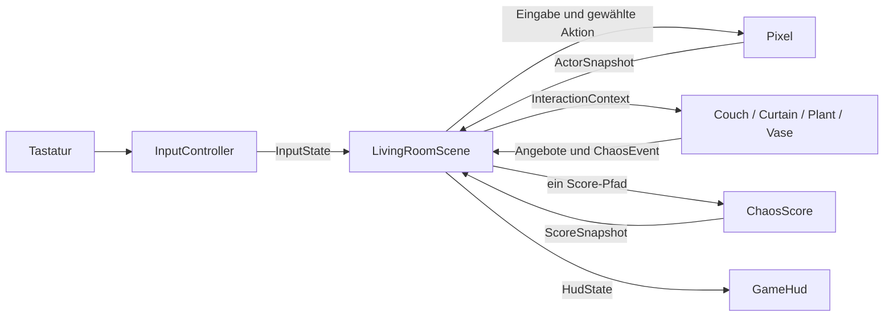

# Gameplay-Architektur und gemeinsame Begriffe

Ausgangspunkt: [Review #22](../reviews/2026-11-02-architecture.md), geprüft nach #36. Der aktuelle Ist-Stand enthält die Extraktionen und typisierten Inhalte aus #37–#42; weitergehende JSON-/Generator-Schritte sind ausdrücklich als geplant beschrieben.

## Ist

`src/main.ts` enthält ausschließlich Bootstrap und Phaser-Konfiguration. `src/game/scenes/LivingRoomScene.ts` baut Raum/Kollisionen auf und koordiniert Input, Pixel, Interaktionen und HUD. `src/game/input/InputController.ts` besitzt Tastaturbindungen und Focus-/Cleanup-Verhalten. Ein eingefrorener `InputState` wird pro Game-Frame genau einmal gelesen; die gecachte Flanke bleibt für alle Verbraucher identisch. `src/game/actors/Pixel.ts` besitzt Bewegung/Klettern, Physikkörper, Blickrichtung, aktive Aktion und Visual-/Animationsanker. Die Szene verwendet das Collider-Objekt ausschließlich zum Verdrahten der Phaser-Kollisionspaare und liest für Interaktionen losgelöste Kontaktdaten. Animationsdaten und reine Auswahlfunktion liegen daneben in `pixel-animations.ts`.

`src/game/ui/GameHud.ts` zeigt weiterhin ausschließlich `HudState` an. `Couch`, `Curtain`, `Plant` und `Vase` unter `src/game/objects/` besitzen jeweils ihre Geometrie, Grafik und ihr reines Zustandsmodell. Interaktionsmodelle liegen unter `src/game/interactions/`, Scoring und unveränderliche Ereignisse unter `src/game/domain/`. Der Content unter `src/content/` beschreibt Objektinstanz-ID, Platzierung, Flächen/Reichweiten und Regeln. Der reine Resolver prüft die Definitionen vor dem Engine-Start und berechnet Auflagen; eine kleine Fabrik übergibt die Ergebnisse als Konfiguration an bekannte Objektklassen. Sitzfläche bzw. Vorhangfläche dienen gleichzeitig Darstellung und Collider/Nähe bzw. Klettern. Regalflächen stehen ebenfalls nur einmal in der Raumdefinition und werden für Darstellung und Collider verwendet. Doppelte IDs im Szenenaufbau werden zurückgewiesen.

Die funktionalen Verträge werden über Komposition verwendet: `Interactable` bietet Eignungsprüfung und Update für automatische Bodenaktionen; `Climbable` bietet Kletterfläche und Update für tatsächliche Bewegung; `Destructible` bietet Schadenssnapshot und maximales Score-Potenzial. `ObjectLifecycle` verbindet Reset/Destroy. Das Sofa ist nur Sprungplattform und Schadensobjekt, kein Vorhang-Kletterobjekt. Keine Marker-Typen für noch nicht implementierte Ziele/Panik und keine verpflichtende Phaser-Vererbungshierarchie.

Ein `ChaosEvent` trägt die als JSON-Tupel codierte ID aus Objektinstanz, Schadensart und Stufe. Alle Schadensarten einschließlich Vasenbruch gelangen über `processDamage` in genau einen `ChaosScore.awardEvent`-Aufruf; erst neue Wertung emittiert `object-damaged`. Die fachlichen Modelle vergeben keine Punkte. `DamageHistory` ist eine kleine reine Komponente für die Objekt-Snapshots, kein zweiter Score-Verbraucher.

Pro Frame erhält das erste geeignete Bodenobjekt der stabilen Szenenreihenfolge ein aktives Update, alle anderen ein inaktives. Dadurch laufen überlappende Wartezeiten/Aktionen nicht parallel; Bewegung, Absprung und Zielwechsel unterbrechen sie. Objekte lesen eingefrorene Pixel-/Input-Daten und melden Aktion/Blickziel zurück, ohne Tastatur oder Pixel-Animation zu steuern. Der Animationsvergleich unter `src/dev/` bleibt ausschließlich im Dev-Betrieb unter seinem bisherigen URL erreichbar. Es bleibt ein npm-/Vite-Projekt.

## Rundenzustand und aktive Spielzeit

`RoundController` besitzt ausschließlich Dauerwahl, aktive Laufzeit, grobe Zeitkategorie,
Phase und finalen Score. Die Zufallsquelle ist für Unit-Tests injizierbar. Snapshots
sind eingefroren. Die geordneten Phasen lauten `chaos → returning → reaction →
reconciliation`. Verfrühte oder wiederholte Phasenwechsel werden zurückgewiesen;
der finale Score und die Rundenuhr bleiben nach der Heimkehr unverändert.

`HomecomingSequence` ist ein reines Modell für Eintritt, Reaktionsmoment, Dialog und
einmaligen Abschluss durch explizite Bestätigung. Der Dialog hat kein Zeitlimit. `selectReaction` verwendet ausschließlich die zentralen
`angerFor`-Grenzen; Dialoge und semantische Animations-Keys stehen in
`src/content/sara-reactions.ts`. Die Zufallsquelle ist injizierbar und wird nur beim
ersten Start ausgewertet. Snapshots und Auswahl sind eingefroren.

Die Szene gibt der Sequenz dieselbe bereinigte aktive Framezeit wie zuvor der Runde.
Sie besitzt Darstellung und Übergabe an die Versöhnung. `SaraReturnView` rendert
Eintrittsbewegung, animiertes Sprite und Dialogpanel ohne eigene Timer oder Tweens;
das pausierte Gameplay hält deshalb Saras aktive Sequenz nicht an. Browserpause
stoppt dagegen auch diese Sequenz. Es existieren keine verzögerten Callbacks, die
nach R einen alten Ablauf fortsetzen könnten. Neustart erzeugt Modell und Ansicht neu.

Der Vertrag für #88 reserviert `sara-enter`, `sara-idle`, `sara-react-calm`,
`sara-react-annoyed` und `sara-react-angry`. Die Domain kennt weder Phaser noch
Sprite-Dateien. Die Ansicht registriert die Clips aus `sara-animations.ts` als normale
Phaser-Animationen und wechselt sie nur bei einem neuen Key. Einmalige Reaktionen
werden dadurch nach ihrem Abschluss nicht pro Frame neu gestartet. Browsersichtbarkeit
pausiert den tatsächlichen Animationszustand unabhängig vom bereits eingefrorenen
Gameplay. Das Sprite verwendet den gemeinsamen Sohlenanker, hat keinen Physikkörper
und wird beim Scene-Shutdown mit der Ansicht entfernt. Derselbe Clipvertrag steuert
auch die nur im Dev-Betrieb verfügbare Größenvergleichsseite. Die anschließende Versöhnung besitzt ein eigenes reines Domain-Modell.

`PlayActivity` kapselt Fensterfokus und Document-Visibility. Beim Wechsel pausiert die
Szene Physik, Tweens und Pixels Animation und leert gehaltene Eingaben. Bei Shutdown
werden alle Fenster-/Document-Listener entfernt. Das erste Delta nach Start/Resume
wird verworfen; normale Schritte sind auf 100 ms begrenzt. Die Arcade-Physik wird
über Phasers `disableUpdate()` vom automatischen UPDATE-Aufruf entkoppelt und genau
einmal pro aktivem Frame aus der Szene mit demselben sicheren Delta wie die Uhr
aktualisiert. Phasers normales `postUpdate` bleibt erhalten; es gibt keine zweite Loop.

Frame-Reihenfolge: Input/Reset → Aktivitätsprüfung → Physik und Kollisionen →
Bewegung/Interaktionen/Score → Rundenuhr → ggf. finaler Score und Freeze → HUD.
Die Aktionen des letzten zulässigen Frames zählen noch. Nach `returning` blockiert
auch der gemeinsame Score-Eingang weitere Ereignisse. Der Input-Snapshot wird
weiter gelesen, damit R jederzeit eine neue Szene starten kann. Die sichtbaren
Zeithinweise entstehen ausschließlich aus `HudState`; nur der E2E-Beobachter enthält
exakte Diagnosezeiten, ohne Schreibzugriffe.

## Frame-Reihenfolge und Lebenszyklus

Ein Input-Snapshot → Reset-Flanke behandeln → Aktivität prüfen und sicheren Physikschritt ausführen → Vasenfall aktualisieren → Pixel bewegen/Klettern bestimmen → Vorhang/Sofa/Pflanze mit demselben Input aktualisieren → Pixel-Aktion/Animation synchronisieren → Rundenuhr/Heimkehr behandeln → HUD synchronisieren. Vorhangschaden wird weiterhin aus tatsächlicher Physikbewegung statt bloßer Renderzeit berechnet.

**R startet jetzt dieselbe Phaser-Szene tatsächlich neu.** `create()` initialisiert Score und Objektlisten neu; neue Adapter besitzen eigene Modelle, Ereignishistorien und Bewegungsreferenzen und durchlaufen den gemeinsamen Reset. Ein neuer Pixel setzt auch Greifsperre, Landepose, Blickrichtung und Bewegungszustand zurück. Shutdown zerstört alle Objektadapter, entfernt eigene Tasten/Captures und den Game-BLUR-Listener und zerstört Pixel/HUD. Die Szene besitzt Grafik, Collider und Tweens; deren Scene-Shutdown räumt die Engine-Ressourcen auf. Gehaltenes R erzeugt keinen wiederholten Neustart. Der asynchron installierte, nur lesbare E2E-Beobachter prüft die Szenengeneration, damit eine alte Importfortsetzung nicht in einen neuen Durchlauf schreibt.

Browserprüfungen beobachten echte Neustarts über R, unveränderte 52×52-Kollision, Eingabeflanken und DOM-Blur/Focus ohne Engine-Mutatoren. Generationsnummer und Listeneranzahl sind ausschließlich skalare Beobachtungswerte; der Produktionsbuild enthält den Testbeobachter nicht.

## Vorgeschlagene Zuständigkeiten

| Baustein                            | Besitzt / tut                                                                                                | Grenze                                                               |
| ----------------------------------- | ------------------------------------------------------------------------------------------------------------ | -------------------------------------------------------------------- |
| `main.ts`                           | Phaser-Bootstrap und Konfiguration                                                                           | Keine Spielregeln oder Objektdarstellung                             |
| `LivingRoomScene`                   | Raum und Objekte erzeugen, Kollisionspaare verdrahten, Update-/Reset-/Shutdown-Reihenfolge                   | Keine Tastenabfragen, Katzenbewegungsdetails oder HUD-Zeichenbefehle |
| `InputController`                   | Hardwarebelegung, einmalige Flankenabfrage, Blur/Cleanup; liefert `InputState`                               | Keine Physics-, Score- oder UI-Entscheidungen                        |
| `Pixel`                             | Physikkörper, Bewegungs-/Kletterzustand, aktive Aktion, Blickrichtung, sichtbares Sprite und Animationsanker | Keine Tastencodes, Möbelzeichnung oder Punktevergabe                 |
| `Couch`, `Curtain`, `Plant`, `Vase` | Eigene Geometrie, Darstellung, Komponenten/Modelle und Lebenszyklus                                          | Keine direkte Tastaturabfrage oder Änderung des Pixel-Sprites        |
| Bestehende reine Modelle            | Wartezeiten, Phasen, Schaden, Ledger und Animationsauswahl                                                   | Keine Abhängigkeit von Phaser, DOM oder Hardware                     |
| `GameHud`                           | Texte, Farben, Balken und Hinweise aus `HudState`                                                            | Keine Punktevergabe, Physics-Zugriffe oder Eingabeabfragen           |

Phaser-Klassen gehören an die Engine-Grenze. Für den derzeit einen Raum genügt eine HUD-View; eine eigene UI-Scene kann bei mehreren Kameras oder übergreifenden Menüs sinnvoll werden. Ein `InputController` ist ein Adapter, keine zweite Game-Loop. Die Szene behält die koordinierende Aufgabe, Regeln bleiben bei den zuständigen Objekten/Modellen.



Die Pfeile zeigen den vorgeschlagenen Datenfluss, keine neue globale Event-Bus-Infrastruktur. Die Szene kann die Ergebnisse synchron weiterreichen. Die kleine Funktion `updateGroundInteractions` übernimmt inzwischen die eindeutige Zielauswahl für Bodenaktionen; Kletterkontakt und physischer Vasenkontakt verwenden ihre konkreten Fähigkeiten.

## Daten an den Grenzen

- **`InputState`**: lesbare Achsen, `jumpPressed`, `resetPressed` und Eingabeaktivität. Flanken werden einmal pro Frame ermittelt. Pixel verarbeitet Bewegung; der Szenenkoordinator verarbeitet einen Neustart. Hardwareadapter können später ausgetauscht werden.
- **`ActorSnapshot` / `InteractionContext`**: lesbare Körpergrenzen, Geschwindigkeit, Boden-/Kletterzustand und Eingabeaktivität. Keine Engine-Objekte in den reinen Regeln.
- **`InteractionOffer` / aktive Aktion**: konkrete Ziel-ID und Handlungsart; höchstens eine automatische Bodenaktion pro Pixel. Bei überlappenden Zielen muss die Auswahl stabil und getestet sein. Bewegung, Absprung oder Zielwechsel brechen die laufende Wartephase ab.
- **`ChaosEvent`**: unveränderliche Tatsache über neu verursachten Schaden mit `id`, `objectId`, `kind`, `stage`, ganzzahligem `value`. Der einzige Score-Pfad ruft das bestehende Ledger auf. Vasenbruch verwendet denselben Vertrag.
- **`HudState`**: lesbare Punkte-/Ärger-Vorschau, Aktionsstatus und Hinweissichtbarkeit. Die Ansicht übersetzt Status in Texte/Grafik; Spielregeln hängen nicht von UI-Formulierungen ab.

Stabile Objekt-ID statt Typname: beispielsweise `living-room/sofa-01` und `living-room/sofa-02`. Eine Ereignis-ID kann aus Objekt-ID, Schadensart und Stufe entstehen. Der vorhandene Durchlauf-Reset leert das Ledger; für die jetzigen Anforderungen braucht es dafür weder Zufalls-UUIDs noch eine Datenbank. Bei persistenten Runden/Raumwechseln ist der Gültigkeitsbereich ausdrücklich festzulegen.

## Ubiquitous Language

| Begriff        | Bedeutung und konkreter Vertrag                                                                                                                                                         | Heutiger Bezug                                                    |
| -------------- | --------------------------------------------------------------------------------------------------------------------------------------------------------------------------------------- | ----------------------------------------------------------------- |
| `Interactable` | Verwendeter TypeScript-Vertrag für automatische Bodenaktionen: Eignung und aktives/inaktives Update. Der sprachliche Oberbegriff interaktiver Objekte umfasst auch andere Kontaktarten. | Sofa, Pflanze; Vorhang nutzt `Climbable`, Vase physischen Kontakt |
| `Interaction`  | Die Handlung samt Warte-/Abbruchzustand; vom Objekt zu unterscheiden.                                                                                                                   | Kratzen, Knabbern, Schubsen, Klettern                             |
| `Destructible` | Besitzt abfragbaren Schadenszustand und meldet neue Schadensstufen über den gemeinsamen Vertrag.                                                                                        | Alle vier aktuellen Interaktionsobjekte                           |
| `Climbable`    | Liefert eine tatsächliche Greif-/Kletterfläche mit Bewegungsparametern.                                                                                                                 | Vorhang; das aktuelle Sofa ist lediglich eine Sprungplattform     |
| `GoalTarget`   | Kann ein konkret definiertes Levelziel erfüllen. Vertrag erst mit dem Zielsystem festlegen.                                                                                             | Geplant in #30, noch nicht implementiert                          |
| `PanicTrigger` | Kann nach konkreten Regeln eine Panikreaktion auslösen. Vertrag erst mit diesem Gameplay festlegen.                                                                                     | Geplant in #33/#35, noch nicht implementiert                      |
| `ChaosEvent`   | Bereits verursachter Schaden, kein Spielobjekttyp und keine beliebige Spieleraktion.                                                                                                    | Kratzer, Riss, Pflanzenbiss/-kippen und Vasenbruch                |

Fähigkeiten sind kombinierbar. Ein späterer Gegenstand kann Ziel, Kletterfläche und beschädigbar sein, ohne drei voneinander ausschließenden Klassen anzugehören. Kleine TypeScript-Interfaces/Komponenten erhalten erst bei einem tatsächlich benutzten Verhalten einen Platz im Code. Eine gemeinsame abstrakte Phaser-Basisklasse ist dafür nicht erforderlich. Die bestehenden reinen Modelle bleiben pro Handlung spezialisiert.

Friedliches Fressen, Schlafen oder Kuscheln kann eine `Interaction` sein, ohne `ChaosEvent` oder Punkte auszulösen. Das heutige Knabbern am Katzengras ist dagegen bereits als Pflanzenschaden definiert. `ChaosObject` eignet sich deshalb nicht als universeller Name für alle interaktiven Gegenstände.

## Lebenszyklus und Reihenfolge

Vorgeschlagene Folge pro Frame: Eingabe lesen → Pixel-Bewegung und aktive Aktion bestimmen → Objektmodelle mit tatsächlichem Kontext/Bewegung aktualisieren → eindeutige Ereignisse verarbeiten → Pixel-Darstellung und HUD synchronisieren. Die bestehende Unterscheidung zwischen Renderzeit und tatsächlicher Vorhangbewegung muss beim Extrahieren erhalten bleiben.

`create/init` initialisiert den Durchlauf ausdrücklich; R führt einen echten Scene-Neustart mit derselben Initialisierung aus. Jeder Besitzer setzt sein Modell, seine visuellen Spuren und Zähler zurück. `shutdown/destroy` meldet Listener, Collider und sonstige Ressourcen ab. Feldinitialisierer allein gelten nicht als Restart-Strategie. Der Testbeobachter erhält weiterhin nur eingefrorene Snapshots ohne Mutatoren.

## Vorgeschlagene Ablage und Content-Grenze

```text
src/
  main.ts                         # gemeinsamer Bootstrap
  game/
    scenes/LivingRoomScene.ts     # Komposition und Lebenszyklus
    input/InputController.ts      # Hardware -> InputState
    actors/Pixel.ts               # Physik, Bewegung, sichtbare Figur
    objects/                      # konkrete Couch, Curtain, Plant, Vase
    interactions/                 # kleine Verträge und reine Handlungsmodelle
    domain/                       # ChaosScore und fachliche Ereignisse
    ui/GameHud.ts                 # Anzeige von HudState
    content/                      # Datenvertrag, Validierung und Aufbau
    assets/                       # bekannte Schlüssel und Vite-URL-Auflösung
  content/
    rooms/                        # typisierte Raumdefinitionen
    objects/                      # typisierte Objektvarianten
  dev/                            # Animationsvergleich und Arbeitswerkzeuge
```

Es bleibt ein npm-/Vite-Projekt mit gemeinsamem Root-Lockfile. `src/game/` bezeichnet die Codeablage; daraus entsteht kein neuer URL-Präfix. Der Dev-Vergleich behält seine URL und Build-Ausgrenzung. Der spätere Pages-Basispfad bleibt Aufgabe #32.

Die Struktur wird schrittweise eingeführt. #37 extrahiert in diesem Stand Szene/Pixel/Controls und trennt Dev-Werkzeuge; #39 hat das HUD isoliert. #38 ergänzt in diesem Stand die Objektadapter und Fähigkeiten. Typisierte Konfiguration wird diesen Klassen übergeben.

### Erst typisierte Definitionen, dann bei Bedarf JSON

[#42](https://github.com/Skanky0815/pixels-world/issues/42) baut das vorhandene Wohnzimmer aus TypeScript-Definitionen wie `RoomDefinition` und einer diskriminierten `ObjectDefinition` auf. Größe, Spawn, Plattformen, Objektinstanzen/IDs, Asset-Schlüssel, Werte und Wartezeiten sind Content. Darstellung, Kollisionen, Aktionsabläufe und Ereignisverarbeitung bleiben implementiertes Verhalten. Eine zweite handgebaute Variante belegt die Daten-/Code-Grenze; das normale Startlevel bleibt unverändert.

Damit können neue Räume und Objektvarianten durch Datenpflege entstehen. Eine neue Mechanik benötigt weiterhin eine Implementierung. Geometrie, Referenzen und zulässige Parameter erhalten eine gemeinsame Datenquelle und passende Prüfungen.

[#43](https://github.com/Skanky0815/pixels-world/issues/43) ergänzt später JSON auf demselben erprobten Vertrag. Eingelesenes JSON benötigt eine Laufzeit-/Importvalidierung; TypeScript-Typen allein prüfen es nicht. Fehler müssen Datei und Datenpfad nennen, bevor Objekte erzeugt werden. Eine versionierte gemeinsame Schemaquelle oder Konsistenztests verhindern doppelte, auseinanderlaufende Definitionen. Keine ausführbaren Skripte, frei instanziierbaren Klassennamen oder allgemeine JSON-Regelsprache.

Die Abhängigkeit ist gerichtet: #37/#38 → #42 → optional #43. #39 wurde als unabhängiger erster Extraktionsschritt vor #37 umgesetzt. Der spätere Generator #29 verwendet denselben Raumvertrag; JSON ist dafür keine Voraussetzung. #32 kann den aktuellen Prototyp unabhängig von diesen Content-Arbeiten veröffentlichen.

Umsetzung: [#37](https://github.com/Skanky0815/pixels-world/issues/37), [#38](https://github.com/Skanky0815/pixels-world/issues/38), [#39](https://github.com/Skanky0815/pixels-world/issues/39); unabhängig davon die bestätigte Validierungslücke [#40](https://github.com/Skanky0815/pixels-world/issues/40). Die Extraktionen #37/#38/#39 sind in diesem Stand umgesetzt; die typisierten Content-Definitionen #42 sind in diesem Stand umgesetzt. JSON #43 und Generator #29 bleiben geplant.

## Umgesetzter Content-Vertrag (#42)

`RoomDefinition` und diskriminierte `ObjectDefinition` liegen unter `src/game/content/`. `src/content/rooms/` und `src/content/objects/` liefern ausschließlich Daten. Die Szene enthält keine festen Objektlisten oder Hintergrundkoordinaten mehr; sie verbindet die erzeugten Adapter und verarbeitet ihre Ergebnisse. Instanz-IDs, Varianten, Assets, Fähigkeiten, Geometrie, sichere Punktwerte und Flächenreferenzen werden vor `Phaser.Game` geprüft. Der Resolver ist unabhängig von Phaser ausführbar; Engine-Typen werden nur für die strukturellen Konstruktor-Konfigurationen importiert und zur Laufzeit entfernt.

Eine zweite handgebaute Raumvariante verändert Platzierung und Werte ohne neue Spielklassen. Sie ist über einen Dev-/E2E-Vorschauparameter wählbar; die Produktion bleibt beim bisherigen Standardraum. Der spätere Generator liefert denselben Raumvertrag, kein paralleles Format. Details: [Content-Leitfaden](../../src/content/README.md).

## Automatische Heimkehr

`PixelReturnController` erzeugt reine Bewegungseingaben aus losgelösten Kontaktdaten.
Er führt Pixel über die Kante einer tragenden Plattform zum Boden und zum gemeinsamen
Sitzanker aus `homecoming-layout.ts`; er verändert keine Physikkörper direkt.
Die Szene deaktiviert nach Rundenende die übrigen dynamischen Körper und lässt nur
Pixels normale Arcade-Bewegung weiterlaufen. Interaktionen und Punkte bleiben gesperrt.
Nach dem Hinsetzen pausiert die Physikwelt. Pixels Animation bleibt bis zur
Browserpause aktiv. Die Bewegungszeit läuft unabhängig vom wartenden Dialog weiter.
`confirmPressed` nutzt eine neue Leertastenflanke ohne native Tastenwiederholung und
bestätigt erst nach dem Hinsetzen. Fokusverlust und R behandeln auch diese Phase.

## Charme-Minispiel

`Reconciliation` verwaltet `waiting → reading → cue → input → feedback/finale → complete/failed`.
Der Start ist einmalig nach bestätigter Heimkehr, ohne erneute Annäherung.
Sequenzen entstehen mit injizierbarem RNG; Snapshots enthalten nur die nächste
aktive Taste. Profile, Rückmeldungen und Zeitwerte liegen im Content.
Die Szene reicht ausschließlich aktive bereinigte Framezeit und frische
Pfeiltastenflanken weiter. `reading` und `feedback` besitzen keine laufende Frist;
eine neue Leertastenflanke startet die nächste Folge. Während der Eingabe
zeigt die Ansicht die große Pfeilkachel und keine Sara-Dialogzeile. Ein Frame kann höchstens eine Eingabe akzeptieren;
mehrere gleichzeitige Pfeile scheitern als mehrdeutige Eingabe. Native Wiederholung
wird im Input-Adapter ausgefiltert. Physik, Schäden und Score bleiben eingefroren.
`ReconciliationView` zeigt nächsten Pfeil, zwei Leisten und textuelle
Zuneigungs-Platzhalter. Sie hat keine Timer und verändert die Figuren nicht.
Fokusverlust pausiert über `PlayActivity`; Neustart baut Modell und Ansicht neu auf.
Der terminale Ausgang wird anschließend in der Ergebnisansicht zusammengefasst.

Das Versuchsbudget aus dem Content gilt pro zu verdienendem Herz, nicht pro Taste.
Der zweite Fehler am selben Herz führt zu `failed`; dieser Endzustand nimmt weder
weitere Eingaben noch Bestätigungen an. Erfolg setzt Budget und Timinghilfe zurück.

## Rundenergebnis

`roundResult` leitet unveränderliche Ergebnisdaten aus den Snapshots von Runde,
Heimkehr und Versöhnung ab. Vor `complete` oder `failed` gibt es kein Ergebnis,
auch während des Streichelmoments noch nicht. Finale Chaospunkte und Saras
ursprüngliche Reaktion bleiben unabhängig vom späteren Versöhnungsausgang.
`RoundResultView` zeigt die gemeinsame Zusammenfassung ohne eigene Timer oder
Eingabelogik; das Versöhnungspanel verschwindet im terminalen Zustand. Der
bestehende R-Neustart baut sämtliche Modelle und Ansichten neu auf und entfernt
so auch die Zusammenfassung. Keine Speicherung oder zusätzliche Punktewertung.

Die Abschlusssprüche stehen in `src/content/round-endings.ts`: drei bestehende
Ärgerstufen mal zwei Versöhnungsausgänge. Die Auswahl verwendet `angerFor`,
keinen weiteren Zufall und keine neue Schwellenlogik. Der ursprüngliche
Heimkehr-Kommentar bleibt im Ergebnisdatensatz erhalten; sichtbar spricht Sara
einen eigenen abschließenden Satz.

## Startfreigabe und Einführung

Die Szene hält die einmalige Startfreigabe getrennt vom Rundenmodell.
Vor der ersten frischen Leertastenflanke wird kein Gameplay-Frame ausgeführt,
die Arcade-Welt und Figurenanimation sind pausiert. Das Startsignal wird
verbraucht; die Tastatur wird beim Übergang nicht zurückgesetzt, damit
eine gehaltene Starttaste nicht als neuer Sprung erscheint.
`StartScreen` besitzt ausschließlich die responsive HTML-Einführung und
bindet das vorhandene README-Banner über Vites Asset-URL ein. Die Szene
steuert Sichtbarkeit und räumt die Ansicht beim Shutdown auf.
Der bestehende Scene-Neustart erhält die Startfreigabe; sämtliche
Rundenmodelle werden weiterhin neu aufgebaut. Keine Persistenz über Reload.

## Herzanforderung

Die Herzanforderung verwendet weiterhin `CHARM_PROFILES.sequences`: 1/2/3
für die zentralen Ärgerstufen. Ein zweites Herzsystem oder neue Chaosgrenzen
sind nicht nötig. Das Profil wird einmal beim Start gewählt, der Zähler bleibt
in der vorhandenen Domain. Die Ansicht zeigt gefüllte/leere Herzen und den
gesammelten/benötigten Zähler; das Budget bleibt zwei Versuche pro Herz.

Der Feedback-Einstieg ist ein normaler Footer-Link mit `target="_blank"` und
`rel="noopener noreferrer"`, ohne Feedback-Backend oder Spielzustandsänderung.
Der Input-Adapter liefert bei Fokus auf interaktiven HTML-Elementen einen
unveränderlichen neutralen Snapshot und löst gehaltene Tasten. Die bestehende
Browserpause behandelt den Wechsel zum neuen Tab.

## Festes Hauptziel und konkurrierende Rundenenden

`RoomDefinition.goal` beschreibt genau ein Ziel; `RoomResolver` prüft ID, Typ,
Texte, Interaktionsdauer, existierende Auflage und Platz innerhalb des Raums.
`ResolvedRoom.goal` enthält die abgeleitete Kontaktfläche. Erreichbarkeit der
konkreten handgebauten Platzierung wird zusätzlich durch echte Tastaturrouten
in beiden Raumvarianten nachgewiesen; es gibt hier keinen allgemeinen Pfadfinder.

`MainGoal` ist ein Phaser-unabhängiges Modell mit aktivem Kontaktfortschritt und
terminalem Zustand `reached` oder `missed`. Es vergibt keine Punkte und besitzt
keinen separaten Timer. Die Szene gibt ihm nur aktive bereinigte Framezeit und
losgelöste Körper-/Eingabedaten nach dem normalen Interaktionsframe. Bewegung
oder falsche Auflage setzt den Kontaktfortschritt zurück. `GoalView` zeichnet
den Spielzeug-Platzhalter und genau einen kurzen Hinweis.

`RoundController.advance` arbitriert Deadline und fertige Zielinteraktion atomar.
Es gelten derselbe letzte Interaktionsframe, einmaliger Score-Freeze und dieselbe
Phasenfolge. Die Deadline gewinnt einen Gleichstand im selben Simulationsframe;
frühe Ziele wechseln sofort zu `returning`. `endReason` bleibt bis zum R-Neustart
fest. Erst dieser akzeptierte Grund finalisiert den Zielstatus, sodass ein
gleichzeitig beobachteter, aber späterer Zielkontakt nicht als Erfolg gezählt wird.
Die Auswertung führt `goalReached` getrennt von Punkten und Versöhnungsausgang.

## Gemeinsame Tastatur- und Pointer-Eingabe

`InputController` liest weiterhin genau einen unveränderlichen Snapshot pro Frame.
Der szeneneigene `TouchControls`-Adapter übersetzt Pointer- und native
Button-Eingaben in gehaltene Aktionen und einmalige Flanken. `PointerActions`
verwaltet Finger getrennt; ein Fingerwechsel darf die Aktion eines anderen nicht
loslassen. Achsen entstehen aus der Vereinigung gehaltener Tasten, Gegenrichtungen
neutralisieren sich. Gleichzeitige Flanken derselben Aktion zählen einmal.

Spielobjekte bleiben frei von DOM-/Touch-Abfragen. Der Adapter verwendet Pointer
Capture, behandelt Verlassen/Cancel/Lost-Capture und wird beim Szenenende samt
AbortController-Listenern entfernt. Blur, Visibility und Resize räumen Eingaben auf.
Die Bestätigungstaste versorgt Start, Dialog und Charmeoffensive über denselben
InputState wie Leertaste. Neustart fragt im Touch-Adapter ausdrücklich nach.
